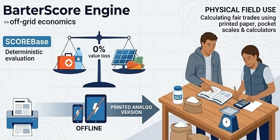

# BarterScore Engine (v1.1.0)

**A Local-First library for Collapse Informatics and Off-Grid Economics.**
*(مكتبة برمجية تعمل محلياً بالكامل لمعلوماتية الأزمات والاقتصاد المستقل عن الشبكة.)*

> **اللغة:**
> [**English (en-US)**](../README.md) · [**Português (pt-BR)**](./README.pt-BR.md) · [**Español (es-ES)**](./README.es-ES.md) · [**Français (fr-FR)**](./README.fr-FR.md) · [**Русский (ru-RU)**](./README.ru-RU.md) · [**Kiswahili (sw-KE)**](./README.sw-KE.md) · [**العربية (ar-SA)**](./README.ar-SA.md) · [**简体中文 (zh-Hans)**](./README.zh-Hans.md) · [**الدليل الميداني الورقي (`OFFLINE_MANUAL.ar-SA.md`)**](./OFFLINE_MANUAL.ar-SA.md)

---

[](https://barterscoreengine.github.io/barterscore/manual_generator.html)

---
<p align="center">
  
</p>

**BarterScore Engine** هو محرك رياضي حتمي، متعدد المنصات، عديم الاعتماديات الخارجية (*Zero-Dependency*)، ويعمل دون اتصال بالإنترنت بنسبة 100% (*Offline-First*)، مزود بدليل مرجعي يضم **128 عنصراً وخدمة قياسية** لتقييم القيمة الفيزيائية والغذائية والوظيفية للسلع الأساسية والخدمات البشرية التخصصية في سيناريوهات انقطاع سلاسل الإمداد، الأزمات الإنسانية، والانهيار المدني.

مرخص بموجب رخصة [**Apache License 2.0**](https://www.apache.org/licenses/LICENSE-2.0)، ومكتوب بالكامل بلغة **Vanilla JavaScript (ES6+ UMD)** و**HTML5/CSS3** القياسية، ليعمل بشكل متطابق عبر البروتوكول المحلي `file://` (بالنقر المزدوج المباشر دون الحاجة إلى Node.js أو خوادم ويب أو اتصال بالإنترنت)، وكذلك في بيئات CommonJS (`module.exports`) وES Modules.

---

## جدول المحتويات

1. [المبادئ المعمارية الأساسية](#1-المبادئ-المعمارية-الأساسية)
2. [المعادلة الرياضية الرسمية](#2-المعادلة-الرياضية-الرسمية)
3. [المنهجية العلمية، سلالم المعايرة، والمصادر المعتمدة (تحقق بنقرة واحدة + تدقيق دون اتصال)](#3-المنهجية-العلمية-سلالم-المعايرة-والمصادر-المعتمدة-تحقق-بنقرة-واحدة--تدقيق-دون-اتصال)
4. [عقد مخطط البيانات (Schema Contract) والتقييس العلمي](#4-عقد-مخطط-البيانات-schema-contract-والتقييس-العلمي)
5. [التشغيل بنقرة واحدة دون إنترنت، طباعة الدليل الورقي، وهيكل المستودع](#5-التشغيل-بنقرة-واحدة-دون-إنترنت-طباعة-الدليل-الورقي-وهيكل-المستودع)
6. [دليل تكامل المطورين ومرجع واجهة البرمجة (API)](#6-دليل-تكامل-المطورين-ومرجع-واجهة-البرمجة-api)
7. [كيفية إضافة العنصر 129+ أو حزمة لغة جديدة](#7-كيفية-إضافة-العنصر-129-أو-حزمة-لغة-جديدة)
8. [الترخيص والحوكمة](#8-الترخيص-والحوكمة)

---

## 1. المبادئ المعمارية الأساسية

- **صفر اعتماديات وقت التشغيل (`file://` أولاً):** تستخدم جميع الوحدات في `src/` و`data/` و`locales/` نمط تعريف الوحدات العالمي الهجين (UMD) الذي يغذي النطاق العام `window.BarterCore` للتشغيل المحلي في المتصفح دون قيود CORS، مع دعم `module.exports` لبيئة Node.js.
- **الفصل التام بين الفيزياء واللغة:** تُحفظ المعاملات الفيزيائية والغذائية حصرياً في `data/items_core.js` باستخدام معرفات دلالية بصيغة `snake_case`. بينما تُحفظ الترجمات التقنية في `locales/[lang].js` وفق معيار [**IETF BCP 47 / RFC 5646**](https://www.rfc-editor.org/info/bcp47) (`en-US`, `pt-BR`, `es-ES`, `fr-FR`, `ru-RU`, `sw-KE`, `ar-SA`, `zh-Hans`) مع سلسلة تراجع تلقائية من ثلاث طبقات:
  ```text
  اللغة المختارة  ───►  en-US (المرجع الأساسي)  ───►  المعرّف التقني (Semantic ID)
  ```
- **حظر العلامات التجارية والالتزام بالوحدة الذرية للاستهلاك:** يُمنع استخدام أي علامة تجارية. جميع العناصر مُعايرة وفق **أصغر وحدة ذرية للاستهلاك** (`قرص واحد`، `بطارية واحدة`، `زجاجة 100 مل`، `عبوة 1000 جرام`) باستخدام [**الأسماء الدولية غير مسجلة الملكية لمنظمة الصحة العالمية (WHO INN)**](https://www.who.int/teams/health-product-and-policy-standards/inn) ودليل [**الهيئة العامة للغذاء والدواء السعودية (SFDA)**](https://www.sfda.gov.sa/) للأدوية، ومواصفات [**SASO / IEC 60086 و61960**](https://webstore.iec.ch/en/publication/603) للبطاريات، و[**الدستور الغذائي (Codex Alimentarius FAO/WHO)**](https://www.fao.org/fao-who-codexalimentarius/) ومواصفات [**SASO / GSO (هيئة التقييس الخليجية)**](https://www.saso.gov.sa/) للأغذية.

---

## 2. المعادلة الرياضية الرسمية

### 2.1. مؤشر التغذية (`IN`)
للعناصر غير الغذائية (`is_food: false`)، يكون `IN = 1.0`. أما للأغذية السعرية (`is_food: true`)، فيُقيّم المؤشر توزيع السعرات الحرارية من البروتين والدهون وكثافة المغذيات الدقيقة الحرجة، محصوراً بدالة `Clamp` ضمن الفترة `[0.5, 2.5]`:

```text
MacroFactor = (pct_kcal_protein × 1.5) + (pct_kcal_fat × 1.0) - (pct_kcal_added_sugar × 1.2)
MicroFactor = (+0.3 إذا كان high_vit_c) + (+0.2 إذا كان high_sodium_potassium) + (+0.2 إذا كان high_calcium_iron)
IN          = Clamp(1.0 + MacroFactor + MicroFactor, 0.5, 2.5)
```

### 2.2. النقاط الأساسية (`ScoreBase`) وإهلاك الصلاحية الفوري
توازن المعادلة بين الطاقة السعرية أو قاعدة الطاقة المكافئة (`E`) مقابل عبء النقل الوزني والحجمي (`P + Vol + 0.1`)، واللوغاريتم العشري لمدة الصلاحية (`log₁₀(V + 1)`)، وتكلفة التحضير (`CP`)، والعامل النفسي (`FP`)، ومتانة التغليف (`Frag`):

```text
ScoreBase = ( (E × IN) / (P + Vol + 0.1) ) × log₁₀(V + 1) × CP × FP × Frag
```

- **الإهلاك الفوري للصلاحية:** عند إدخال الأيام المتبقية الفعلية `current_lifecycle_remaining` (أو `offerRemainingDays`)، فإنها تحل محل الصلاحية القياسية `lifecycle_units` (`V`). وإذا كان `V ≤ 0`، يُعتبر العنصر منتهي الصلاحية وتكون `ScoreBase = 0`.

### 2.3. مُعدِّل السياق الخارجي (`MEC`) والنقاط النهائية

```text
ScoreFinal = ScoreBase × MEC
```

- **`acute_collapse` (الانهيار المدني الحاد):** تُخفّض فئة مخازن القيمة `cat_store_of_value` (المعادن الثمينة) إلى **`0.01x`**، بينما تحصل مياه الشرب، أدوات وقف النزيف، المضادات الحيوية، والحصص الجاهزة على مضاعفات الندرة القصوى.
- **`economic_reconstruction` (إعادة الإعمار الاقتصادي):** ترتفع فئة `cat_store_of_value` إلى **`5.0x`** جنباً إلى جنب مع الأدوات الفولاذية المتينة، البذور مفتوحة التلقيح، الألواح الشمسية، وأجهزة الاتصال اللاسلكي VHF/UHF.

### 2.4. تكافؤ المقايضة الثنائية وتنبيه عدم قابلية التجزئة (`calculateTrade`)
عند مقايضة عنصر معروض `A` (بكمية `Q_A`) مقابل عنصر مطلوب `B`:

```text
Q_B_exact = ( ScoreFinal(A) × Q_A ) / ScoreFinal(B)
```

إذا كان العنصر `B` غير قابل للتجزئة (`is_divisible: false`)، يُقرّب المحرك الكمية الموصى بها إلى أقرب عدد صحيح (`Q_B_rec = max(1, round(Q_B_exact))`) ويُصدر تقرير `trade_imbalance` / `tradeImbalanceWarning` الذي يوضح بدقة **من المدين بالباقي (الفكة) للآخر** (`أنت مدين بالباقي للطرف المقابل` أو `الطرف المقابل مدين لك بالباقي`)، ونسبة الفائض أو العجز، وخيارات تسوية الفكة باستخدام سلع قابلة للتجزئة (`جرام`، `مل`، `وحدة`).

---

## 3. المنهجية العلمية، سلالم المعايرة، والمصادر المعتمدة (تحقق بنقرة واحدة + تدقيق دون اتصال)

### 3.0. المعنى الفيزيائي لـ `نقطة BarterScore واحدة (1 pt)` ولماذا يساوي العنصر B ضعف (`2x`) العنصر A
من التحليل البُعدي للمعادلة `ScoreBase = ((E × IN) / (P + Vol + 0.1)) × log₁₀(V + 1) × CP × FP × Frag`:
- **التعريف الفيزيائي لـ `1.0000 pt`:** **`نقطة BarterScore واحدة`** تعادل **1 كيلو كالوري فعال من منفعة البقاء (`E × IN = 1`) لكل وحدة عبء نقل وزني وحجمي (`P + Vol + 0.1 = 1.0`) مستدامة عبر عقد لوغاريتمي واحد من الصلاحية (`V = 9 أيام` → `log₁₀(10) = 1.0`) عند جاهزية تشغيلية محايدة (`CP = 1.0`, `FP = 1.0`, `Frag = 1.0`)**.

### 3.1. المصادر العلمية والتنظيمية والإنسانية المعتمدة (نسخة محلية في `audit_sources/` + روابط مباشرة)

| المجال / النطاق | الجهة الرسمية ورمز الوثيقة / السجل الدقيق | رابط التحقق المباشر بنقرة واحدة |
| :--- | :--- | :--- |
| **ملف التدقيق المحلي دون اتصال** | سجل المصادر المحلي (`audit_sources/`) | [`../audit_sources/OFFLINE_AUDIT_DOSSIER.md`](../audit_sources/OFFLINE_AUDIT_DOSSIER.md) |
| **التغذية: الأرز الأبيض (`365 kcal/100g`)** | USDA FoodData Central — `FDC ID: 169756` (`NDB 20444`) | [https://fdc.nal.usda.gov/food-details/169756/nutrients](https://fdc.nal.usda.gov/food-details/169756/nutrients) |
| **التغذية: الفاصوليا الجافة (`329–341 kcal/100g`)** | USDA FoodData Central — `FDC ID: 173734` (`NDB 16014`) & TBCA `C0113A` | [https://fdc.nal.usda.gov/food-details/173734/nutrients](https://fdc.nal.usda.gov/food-details/173734/nutrients) |
| **التغذية: العسل والسكر والزيت** | USDA FDC IDs `169640`, `169655` & `171411` | [https://fdc.nal.usda.gov/food-details/169640/nutrients](https://fdc.nal.usda.gov/food-details/169640/nutrients) |
| **المواصفات الغذائية الدولية** | هيئة الدستور الغذائي (FAO/WHO Codex Alimentarius) | [https://www.fao.org/fao-who-codexalimentarius/](https://www.fao.org/fao-who-codexalimentarius/) |
| **الأدوية الأساسية (`J01CA04` وغيرها)** | القائمة النموذجية الـ23 لمنظمة الصحة العالمية (`WHO/MHP/HPS/EML/2023.02`) | [https://iris.who.int/handle/10665/371090](https://iris.who.int/handle/10665/371090) |
| **أملاح الإماهة الفموية (`20.5 g/L`)** | مواصفة WHO / UNICEF منخفضة الأسمولية (`WHO/FCH/CAH/06.1`) | [https://iris.who.int/handle/10665/69227](https://iris.who.int/handle/10665/69227) |
| **الأسماء الدوائية غير التجارية** | الأسماء الدولية غير مسجلة الملكية (WHO INN) | [https://www.who.int/teams/health-product-and-policy-standards/inn](https://www.who.int/teams/health-product-and-policy-standards/inn) |
| **حقائب الطوارئ الصحية الإنسانية** | WHO / UNHCR / UNICEF IEHK 2017 | [https://www.who.int/emergencies/emergency-health-kits/interagency-emergency-health-kit-2017](https://www.who.int/emergencies/emergency-health-kits/interagency-emergency-health-kit-2017) |
| **إصابات النزيف الشرياني الميدانية** | إرشادات CoTCCC / US DoD TCCC | [https://deployedmedicine.com/market/31](https://deployedmedicine.com/market/31) |
| **حماية الغدة الدرقية من الإشعاع** | دليل US FDA ديسمبر 2001 — يوديد البوتاسيوم (`130 mg`) | [https://www.fda.gov/drugs/bioterrorism-and-drug-preparedness/frequently-asked-questions-potassium-iodide-ki](https://www.fda.gov/drugs/bioterrorism-and-drug-preparedness/frequently-asked-questions-potassium-iodide-ki) |
| **التسمية القياسية `en-US`** | دستور الأدوية الأمريكي (USP) & FDA Orange Book | [https://www.usp.org/](https://www.usp.org/) · [https://www.accessdata.fda.gov/scripts/cder/ob/](https://www.accessdata.fda.gov/scripts/cder/ob/) |
| **التسمية القياسية `pt-BR`** | DCB / ANVISA (التسمية البرازيلية المشتركة) | [https://www.gov.br/anvisa/pt-br/assuntos/farmacopeia/dcb](https://www.gov.br/anvisa/pt-br/assuntos/farmacopeia/dcb) |
| **التسمية القياسية `es-ES`** | DOE / CIMA AEMPS & BOE `BOE-A-1967-16485` (CAE) | [https://cima.aemps.es/](https://cima.aemps.es/) · [https://www.boe.es/buscar/act.php?id=BOE-A-1967-16485](https://www.boe.es/buscar/act.php?id=BOE-A-1967-16485) |
| **التسمية القياسية `fr-FR`** | DCI / ANSM (Pharmacopée Française) & ANSES Table Ciqual | [https://ansm.sante.fr/documents/reference/pharmacopee](https://ansm.sante.fr/documents/reference/pharmacopee) · [https://ciqual.anses.fr/](https://ciqual.anses.fr/) |
| **التسمية القياسية `ru-RU`** | МНН / ГРЛС Минздрава РФ (ГФ РФ XV) & Росстандарт (ГОСТ) | [https://grls.rosminzdrav.ru/](https://grls.rosminzdrav.ru/) · [https://protect.gost.ru/](https://protect.gost.ru/) |
| **التسمية القياسية `sw-KE`** | KEML / PPB Kenya (Pharmacy and Poisons Board) & KEBS / KFCT | [https://web.pharmacyboardkenya.org/](https://web.pharmacyboardkenya.org/) · [https://www.kebs.org/](https://www.kebs.org/) |
| **التسمية القياسية `ar-SA`** | الهيئة العامة للغذاء والدواء (SFDA) والهيئة السعودية للمواصفات والمقاييس (SASO / GSO) | [https://www.sfda.gov.sa/](https://www.sfda.gov.sa/) · [https://www.saso.gov.sa/](https://www.saso.gov.sa/) |
| **التسمية القياسية `zh-Hans`** | دستور الأدوية الصيني (ChP) والمواصفات الوطنية GB (SAMR) | [https://www.chp.org.cn/](https://www.chp.org.cn/) · [https://openstd.samr.gov.cn/](https://openstd.samr.gov.cn/) |
| **تطهير المياه وأقراص NaDCC (`67mg/20L`)** | معيار Sphere WASH 2.1 (`15L/يوم`) & WHO GDWQ `978-92-4-154995-0` | [https://spherestandards.org/handbook/editions/](https://spherestandards.org/handbook/editions/) · [https://www.who.int/publications/i/item/9789241549950](https://www.who.int/publications/i/item/9789241549950) |
| **البطاريات (`LR6`, `LR03`, `INR18650`)** | IEC 60086-2 & IEC 61960-3 | [https://webstore.iec.ch/en/publication/603](https://webstore.iec.ch/en/publication/603) |
| **كمامات ترشيح الجسيمات (`N95 / FFP2`)** | SASO / CDC NIOSH `42 CFR Part 84` | [https://www.cdc.gov/niosh/npptl/topics/respirators/disp_part/n95list1.html](https://www.cdc.gov/niosh/npptl/topics/respirators/disp_part/n95list1.html) |
| **المعادن الثمينة (`عيار 999.0`)** | مواصفات LBMA Good Delivery | [https://www.lbma.org.uk/good-delivery/about-good-delivery](https://www.lbma.org.uk/good-delivery/about-good-delivery) |
| **الجراحة الطارئة والتوليد** | WHO IMEESC & WHO/UNFPA/UNICEF IMPAC (`978-92-4-156549-3`) | [https://www.who.int/publications/i/item/9789241565493](https://www.who.int/publications/i/item/9789241565493) |
| **العمل التقني ومعدلات الأيض المهني** | ILO ISCO-08 & ISO 8996 | [https://ilostat.ilo.org/methods/concepts-and-definitions/classification-occupation/](https://ilostat.ilo.org/methods/concepts-and-definitions/classification-occupation/) · [https://www.iso.org/standard/74443.html](https://www.iso.org/standard/74443.html) |
| **شبكات الطوارئ، استعادة البيانات، ولحام اللوحات** | IEEE 802.11s, ISO/IEC 27037, IPC-7711/7721 & IEC 61131-3 | [https://standards.ieee.org/ieee/802.11s/4570/](https://standards.ieee.org/ieee/802.11s/4570/) · [https://www.iso.org/standard/44381.html](https://www.iso.org/standard/44381.html) |
| **التعليم التقني والترجمة الهندسية** | UNESCO ISCED, WHO/ICRC BEC & ISO 17100:2015 | [https://uis.unesco.org/en/topic/international-standard-classification-education-isced](https://uis.unesco.org/en/topic/international-standard-classification-education-isced) · [https://www.iso.org/standard/59149.html](https://www.iso.org/standard/59149.html) |

---

## 4. عقد مخطط البيانات (Schema Contract) والتقييس العلمي

يتم تدقيق كل عنصر في `data/items_core.js` أو مسجل عبر `BarterEngine.registerCustomItems([item])` بواسطة `window.BarterCore.Validator.validateItem(item)`:

| الخاصية | النوع | القيود / القيم المسموحة |
| :--- | :--- | :--- |
| `id` | `string` | أحرف إنجليزية صغيرة بصيغة `snake_case` (`/^[a-z][a-z0-9_]{2,120}$/`)، غير رقمي، خالٍ من العلامات التجارية |
| `category` | `string` | `cat_staple_foods`, `cat_critical_nutrition`, `cat_spices_morale`, `cat_pharma_essential`, `cat_trauma_hygiene`, `cat_water_fire_shelter`, `cat_tools_energy_comms`, `cat_store_of_value`, `cat_essential_services` |
| `is_food` | `boolean` | `true` للأغذية السعرية؛ `false` للسلع غير الغذائية والأدوية والأدوات والخدمات |
| `is_divisible` | `boolean` | `true` إذا كان قابلاً للتجزئة إلى `sub_units`؛ `false` إذا كان يُتداول كوحدة كاملة فقط |
| `sub_units` | `number` | عدد صحيح `≥ 1` (`1` لغير القابل للتجزئة؛ إجمالي الجرامات `g` أو المليلترات `ml` أو الوحدات الفرعية للقابل للتجزئة) |
| `unit_measure` | `string` | `"g"` \| `"ml"` \| `"un"` |
| `energy_or_utility_base` | `number` | `> 0` (إجمالي السعرات `kcal` للأغذية؛ أو `EEB` ضمن `[500, 50000]` لغير الأغذية) |
| `weight_kg` | `number` | الكتلة الفيزيائية بالكيلوجرام (`> 0`) |
| `volume_liters` | `number` | الحجم الفيزيائي باللتر (`≥ 0`) |
| `lifecycle_units` | `number` | مدة الصلاحية القياسية للعبوة المغلقة أو استدامة الخدمة بالأيام (`> 0`) |
| `cost_of_prep` | `number` | معامل سهولة التحضير ضمن الفترة `[0.5, 1.0]` |
| `psychological_factor` | `number` | معامل الطلب النفسي والمعنوي ضمن الفترة `[1.0, 2.5]` |
| `fragility_index` | `number` | معامل متانة التغليف ضمن الفترة `[0.7, 1.2]` |
| `tags` | `string[]` | مصفوفة غير فارغة من الوسوم الوظيفية بصيغة `snake_case` |

---

## 5. التشغيل بنقرة واحدة دون إنترنت، طباعة الدليل الورقي، وهيكل المستودع

- **نظام Windows (7 / 10 / 11):** انقر نقراً مزدوجاً على `start_windows.bat` في المجلد الرئيسي.
- **أنظمة Linux / macOS / FreeBSD / OpenBSD:** نفّذ الأمر `./start_unix.sh` (أو `sh ./start_unix.sh`).
- **الفتح المباشر في المتصفح:** انقر نقراً مزدوجاً على `manual_generator.html` مباشرة من أي مدير ملفات مكتبي أو هاتفي.
- **دعم اتجاه الكتابة من اليمين إلى اليسار (`RTL`) وطباعة الدليل الميداني الورقي:** عند اختيار اللغة **`العربية (ar-SA)`** داخل `manual_generator.html`، تتحول الواجهة والجدول المطبوع تلقائياً إلى اتجاه `dir="rtl"`. اضغط على **"طباعة الدليل الميداني"** (`Ctrl+P` / `Cmd+P`) لطباعة الدليل الورقي الكامل بتنسيق `A4 landscape` شاملاً الصفحة الأولى (دليل التشغيل اليدوي وجدول الفكة السريع) وجميع العناصر الـ128 عبر سيناريوهات الأزمة الثلاثة جنباً إلى جنب.

### 5.1. البنية المعمارية للمستودع

```text
library/
├── .gitattributes                      # يفرض LF لملفات .sh وCRLF لملفات .bat وقواعد GitHub Linguist
├── .gitignore                          # يحمي المستودع من ملفات التخزين المؤقت لنظام التشغيل وبيئات التطوير
├── LICENSE                             # رخصة Apache License 2.0 الرسمية
├── NOTICE                              # إشعار الإسناد الإلزامي (المادة 4d — Erisson Marques)
├── README.md                           # الوثائق الإنجليزية الأساسية ومرجع SDK
├── CHANGELOG.md                        # سجل الإصدارات وفق معيار Keep a Changelog v1.1.0
├── CONTRIBUTING.md                     # قاعدة Inbound=Outbound وملكية الرعاية بنسبة 100% للمطور الرئيسي
├── package.json                        # بيان حزمة npm عديمة الاعتماديات والبيانات الوصفية
├── server.js                           # خادم HTTP محلي مدمج بلغة Node.js (صفر اعتماديات) للمعاينة المحلية
├── index.js                            # نقطة الدخول الموحدة UMD للحزمة (@barterscoreengine/library)
├── index.d.ts                          # تعريفات أنواع TypeScript الرسمية لبيئات التطوير والمشاريع الخارجية
├── start_windows.bat                   # مشغل Windows بنقرة واحدة (بروتوكول file://)
├── start_unix.sh                       # مشغل POSIX بنقرة واحدة (Linux, macOS, BSD)
├── manual_generator.html               # واجهة المستخدم الرسومية دون اتصال، محاكي المقايضة، ومولد الدليل المطبوع A4
├── attachments/                        # الشعارات واللافتات والأيقونات والموارد البصرية للمشروع
├── data/
│   └── items_core.js                   # 128 عنصراً وخدمة قياسية (9 فئات: 100 سلعة + 28 خدمة) + قالب العنصر 129+
├── audit_sources/
│   ├── OFFLINE_AUDIT_DOSSIER.md        # ملف التدقيق العلمي وسلالم المعايرة العشرية دون اتصال
│   └── offline_sources_registry.js     # سجل المصادر العلمية المدمج UMD (window.BarterCore.AuditSources)
├── locales/
│   ├── en-US.js                        # الإنجليزية (WHO INN / USP / Codex Alimentarius)
│   ├── pt-BR.js                        # البرتغالية البرازيلية (DCB-ANVISA / TBCA-TACO)
│   ├── es-ES.js                        # الإسبانية (DOE-AEMPS / Código Alimentario Español)
│   ├── fr-FR.js                        # الفرنسية (DCI-ANSM / Pharmacopée Française / ANSES-Ciqual)
│   ├── ru-RU.js                        # الروسية (MNN-GRLS Minzdrav RF / State Pharmacopoeia XV / GOST)
│   ├── sw-KE.js                        # السواحيلية (WHO INN / KEML-PPB Kenya / KEBS-KFCT)
│   ├── ar-SA.js                        # العربية (WHO INN / SFDA / SASO-GSO / Codex Alimentarius)
│   └── zh-Hans.js                      # الصينية المبسطة (Chinese Pharmacopoeia ChP / GB)
├── docs/
│   ├── OFFLINE_MANUAL.md               # الدليل الميداني الورقي المستقل بالإنجليزية (en-US)
│   ├── OFFLINE_MANUAL.pt-BR.md         # الدليل الميداني الورقي المستقل بالبرتغالية البرازيلية
│   ├── OFFLINE_MANUAL.es-ES.md         # الدليل الميداني الورقي المستقل بالإسبانية
│   ├── OFFLINE_MANUAL.fr-FR.md         # الدليل الميداني الورقي المستقل بالفرنسية
│   ├── OFFLINE_MANUAL.ru-RU.md         # الدليل الميداني الورقي المستقل بالروسية
│   ├── OFFLINE_MANUAL.sw-KE.md         # الدليل الميداني الورقي المستقل بالسواحيلية
│   ├── OFFLINE_MANUAL.ar-SA.md         # الدليل الميداني الورقي المستقل بالعربية
│   ├── OFFLINE_MANUAL.zh-Hans.md       # الدليل الميداني الورقي المستقل بالصينية المبسطة
│   ├── README.pt-BR.md                 # الوثائق الكاملة بالبرتغالية البرازيلية
│   ├── README.es-ES.md                 # الوثائق الكاملة بالإسبانية
│   ├── README.fr-FR.md                 # الوثائق الكاملة بالفرنسية
│   ├── README.ru-RU.md                 # الوثائق الكاملة بالروسية
│   ├── README.sw-KE.md                 # الوثائق الكاملة بالسواحيلية
│   ├── README.ar-SA.md                 # الوثائق الكاملة بالعربية
│   └── README.zh-Hans.md               # الوثائق الكاملة بالصينية المبسطة
└── src/
    ├── barter_engine.js                # المحرك الرياضي ومحرك المقايضة الأساسي UMD (صفر اعتماديات)
    └── validator.js                    # مدقق المخطط والبيانات وحزم اللغات UMD (صفر اعتماديات)
```

---

## 6. دليل تكامل المطورين ومرجع واجهة البرمجة (API)

```javascript
import { BarterEngine, Validator, ItemsCore, Locales, AuditSources } from '@barterscoreengine/library';

const engine = new BarterEngine({
  items: ItemsCore,
  locales: Locales,
  locale: 'ar-SA',
  crisisPhase: 'acute_collapse'
});

const itemScore = engine.evaluateItem('water_potable_sealed_1000ml');
console.log('اسم العنصر:', engine.translate('water_potable_sealed_1000ml', 'name', 'ar-SA'));
console.log('النقاط النهائية:', itemScore.final_score); // 16458.3288
```

---

## 7. كيفية إضافة العنصر 129+ أو حزمة لغة جديدة

استخدم الدالة `BarterEngine.registerCustomItems([item], { mode: 'merge', strict: true })` لتسجيل سلع أو خدمات إقليمية جديدة بدءاً من **العنصر 129+ (`Items 129+`)**، أو انسخ القالب `locales/en-US.js` إلى `locales/[bcp47-code].js` وافحصه عبر `Validator.validateLocale(customLocale, ItemsCore)`.

---

## 8. الترخيص والحوكمة

يُوزّع هذا المشروع بموجب رخصة [**Apache License 2.0**](../LICENSE). وعملاً بالمادة 4(d) من رخصة Apache License 2.0، يجب أن تحتفظ جميع النسخ أو الأعمال المشتقة بملف [`NOTICE`](../NOTICE) المتضمن إسناد المؤلف والمطور الرئيسي: **Erisson Marques** ([`https://github.com/erissontech`](https://github.com/erissontech)) والرابط الرسمي للمستودع ([`https://github.com/barterscoreengine/library`](https://github.com/barterscoreengine/library)).
