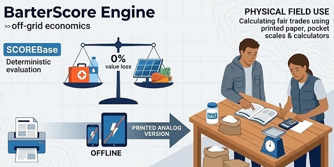

# BarterScore Engine (v1.1.0)

**A Local-First library for Collapse Informatics and Off-Grid Economics.**
*(Una biblioteca Local-First para Informática del Colapso y Economía Off-Grid.)*

> **Idioma:**
> [**English (en-US)**](../README.md) · [**Português (pt-BR)**](./README.pt-BR.md) · [**Español (es-ES)**](./README.es-ES.md) · [**Français (fr-FR)**](./README.fr-FR.md) · [**Русский (ru-RU)**](./README.ru-RU.md) · [**Kiswahili (sw-KE)**](./README.sw-KE.md) · [**العربية (ar-SA)**](./README.ar-SA.md) · [**简体中文 (zh-Hans)**](./README.zh-Hans.md) · [**Manual Analógico (`OFFLINE_MANUAL.es-ES.md`)**](./OFFLINE_MANUAL.es-ES.md)

---
<p align="center">
  
</p>

**BarterScore Engine** es un motor matemático determinista, multiplataforma, sin dependencias externas y 100% *offline-first*, diseñado para evaluar científicamente el valor físico, nutricional y funcional de artículos esenciales y servicios humanos especializados para el trueque en escenarios de interrupción de la cadena de suministro, crisis humanitarias y colapso civil.

Licenciado bajo [**Apache License 2.0**](https://www.apache.org/licenses/LICENSE-2.0), toda la arquitectura está escrita en **Vanilla JavaScript puro (ES6+ UMD)** y **HTML5/CSS3** nativos, funcionando de forma idéntica bajo el protocolo local `file://` (mediante doble clic, sin requerir Node.js, servidores web ni conexión a internet), CommonJS (`module.exports`) y entornos ES Modules.

---

## Índice

1. [Principios Arquitectónicos Fundamentales](#1-principios-arquitectónicos-fundamentales)
2. [La Fórmula Matemática Oficial](#2-la-fórmula-matemática-oficial)
3. [Metodología Científica, Rúbrica de Calibración y Fuentes Oficiales (1 Clic + Auditoría Offline)](#3-metodología-científica-rúbrica-de-calibración-y-fuentes-oficiales-1-clic--auditoría-offline)
4. [Contrato de Esquema y Estandarización Científica](#4-contrato-de-esquema-y-estandarización-científica)
5. [Ejecución Offline en 1 Clic, Impresión Física y Estructura del Repositorio](#5-ejecución-offline-en-1-clic-impresión-física-y-estructura-del-repositorio)
6. [Guía de Integración para Desarrolladores y Referencia de la API](#6-guía-de-integración-para-desarrolladores-y-referencia-de-la-api)
7. [Cómo Añadir el Artículo 129+ o un Nuevo Idioma](#7-cómo-añadir-el-artículo-129-o-un-nuevo-idioma)
8. [Licencia y Gobernanza](#8-licencia-y-gobernanza)

---

## 1. Principios Arquitectónicos Fundamentales

- **Cero Dependencias en Tiempo de Ejecución (`file://` First):** Todos los módulos en `src/`, `data/` y `locales/` emplean un patrón UMD híbrido que expone `window.BarterCore` para ejecución local en el navegador sin bloqueos CORS, además de soportar `module.exports`.
- **Desacoplamiento Total (Física vs. Idioma):** La física y la matemática de los artículos están aisladas en `data/items_core.js` mediante identificadores semánticos en `snake_case`. Las traducciones técnicas están aisladas en `locales/[lang].js` siguiendo la norma [**IETF BCP 47 / RFC 5646**](https://www.rfc-editor.org/info/bcp47) (`en-US`, `pt-BR`, `es-ES`, `fr-FR`, `ru-RU`, `sw-KE`, `ar-SA`, `zh-Hans`) con *Fallback* automático en tres niveles:
  ```text
  Idioma Seleccionado  ───►  en-US (Base Canónica)  ───►  ID Técnico Semántico
  ```
- **Cero Marcas Comerciales:** Queda estrictamente prohibido el uso de marcas comerciales. Todos los artículos se normalizan por **Unidad Atómica de Consumo** (`1 comprimido`, `1 pila`, `1 rollo`, `1 frasco 100ml`, `1 paquete 1000g`) utilizando nomenclatura [**OMS/INN**](https://www.who.int/teams/health-product-and-policy-standards/inn) ([**DOE/AEMPS**](https://cima.aemps.es/) en España) para medicamentos, [**IEC 60086 / IEC 61960**](https://webstore.iec.ch/en/publication/603) para pilas/baterías y [**Codex Alimentarius (FAO/OMS)**](https://www.fao.org/fao-who-codexalimentarius/) / [**CAE**](https://www.boe.es/buscar/act.php?id=BOE-A-1967-16485) para alimentos.

---

## 2. La Fórmula Matemática Oficial

### 2.1. Índice Nutricional (`IN`)
Para artículos no alimentarios (`is_food: false`), `IN = 1.0`. Para alimentos calóricos (`is_food: true`), el índice evalúa la proporción calórica de macronutrientes y la densidad de micronutrientes críticos, acotado mediante `Clamp` al intervalo `[0.5, 2.5]`:

```text
MacroFactor = (pct_kcal_protein × 1.5) + (pct_kcal_fat × 1.0) - (pct_kcal_added_sugar × 1.2)
MicroFactor = (+0.3 si high_vit_c) + (+0.2 si high_sodium_potassium) + (+0.2 si high_calcium_iron)
IN          = Clamp(1.0 + MacroFactor + MicroFactor, 0.5, 2.5)
```

### 2.2. Puntuación Base (`ScoreBase`) y Depreciación en Tiempo Real
Equilibra la energía calórica o la Base de Energía Equivalente (`E`) frente a la penalización gravimétrica y volumétrica de transporte (`P + Vol + 0.1`), la longevidad logarítmica en base 10 (`log₁₀(V + 1)`), el coste de preparación (`CP`), el factor psicológico (`FP`) y la resistencia física del envase (`Frag`):

```text
ScoreBase = ( (E × IN) / (P + Vol + 0.1) ) × log₁₀(V + 1) × CP × FP × Frag
```

- **Depreciación en Tiempo Real:** Cuando se informa `current_lifecycle_remaining` (u `offerRemainingDays`) en tiempo real, sustituye a la vida útil nominal `lifecycle_units` (`V`). Si `V ≤ 0`, el artículo está caducado y `ScoreBase = 0`.

### 2.3. Modificador de Contexto Externo (`MEC`) y Puntuación Final

```text
ScoreFinal = ScoreBase × MEC
```

- **`acute_collapse` (Colapso Agudo):** La categoría `cat_store_of_value` se penaliza a **`0.01x`**, mientras que el agua potable, los hemostáticos, los antibióticos sistémicos y las raciones listas para el consumo reciben multiplicadores de escasez aguda.
- **`economic_reconstruction` (Reconstrucción Económica):** La categoría `cat_store_of_value` se revaloriza a **`5.0x`**, junto con herramientas manuales duraderas, semillas de polinización abierta, paneles solares y radios transceptores VHF/UHF.

### 2.4. Paridad Bilateral de Trueque y Alerta de Indivisibilidad (`calculateTrade`)
Dado un artículo ofrecido `A` (cantidad `Q_A`) y un artículo solicitado `B`:

```text
Q_B_exacta = ( ScoreFinal(A) × Q_A ) / ScoreFinal(B)
```

Si el artículo `B` es indivisible (`is_divisible: false`), el motor redondea la cantidad recomendada al entero más próximo (`Q_B_rec = max(1, round(Q_B_exacta))`) y genera el informe estructurado `trade_imbalance` / `tradeImbalanceWarning`, indicando el porcentaje exacto de excedente o déficit de valor y sugiriendo compensar la diferencia con artículos divisibles de alta liquidez (como sal yodada en gramos o comprimidos sueltos).

---

## 3. Metodología Científica, Rúbrica de Calibración y Fuentes Oficiales (1 Clic + Auditoría Offline)

¿Por qué cada artículo del catálogo recibe exactamente su puntuación, qué significa físicamente **`1 Punto BarterScore (1 pt)`** y por qué un Artículo B obtiene el doble (`2x`) de puntos que un Artículo A? Dado que ningún organismo gubernamental publica una ecuación unificada que compare directamente *1 kg de arroz* con *1 cápsula de amoxicilina* o *1 batería recargable 18650*, **BarterScore Engine** sintetiza **registros empíricos oficiales verificados** (archivados localmente para auditoría sin internet en [`audit_sources/`](../audit_sources/OFFLINE_AUDIT_DOSSIER.md) y con enlaces directos abajo) con **rúbricas de ingeniería por escalones decimales explícitamente justificadas**.

### 3.0. Significado Físico de `1 Punto BarterScore (1 pt)` y Por Qué un Artículo Vale `2x` Otro
Por análisis dimensional de `ScoreBase = ((E × IN) / (P + Vol + 0.1)) × log₁₀(V + 1) × CP × FP × Frag`:
- **Definición Física de `1.0000 pt`:** **`1 Punto BarterScore`** equivale exactamente a **1 Kilocaloría Efectiva de Supervivencia (`E × IN = 1`) por unidad de Carga Logística Gravimétrica-Volumétrica (`P + Vol + 0.1 = 1.0`), sostenida durante 1 Década Logarítmica de Vida Útil (`V = 9 días` → `log₁₀(10) = 1.0`) en disponibilidad operativa neutra (`CP = 1.0`, `FP = 1.0`, `Frag = 1.0`)**.
- **Por qué el Artículo B recibe `2.0x` los puntos del Artículo A:** Manteniendo constantes las demás variables, la puntuación se duplica cuando: **(1)** aporta el doble (`2×`) de kilocalorías metabolizables (`kcal`) o ahorro metabólico `EEB` (`E`); **(2)** concentra la misma utilidad en la mitad de peso y volumen combinados (`P + Vol + 0.1`); **(3)** su vida útil se eleva al cuadrado en la escala logarítmica de base 10 (por ejemplo, `1.000 días` [`log₁₀ ≈ 3,0`] frente a `31 días` [`log₁₀ ≈ 1,5`]); o **(4)** su producto operativo (`CP × FP × Frag`) es dos veces mayor.

### 3.1. Fuentes Científicas, Regulatorias y Gubernamentales Oficiales (Snapshot Offline en `audit_sources/` + Enlaces en 1 Clic)
> **Auditoría 100% Offline (`audit_sources/`):** Todas las consultas de fuentes, códigos **USDA FDC ID**, códigos **ATC de la OMS** y formulaciones oficiales están guardados localmente en [`audit_sources/OFFLINE_AUDIT_DOSSIER.md`](../audit_sources/OFFLINE_AUDIT_DOSSIER.md) y en el módulo UMD [`audit_sources/offline_sources_registry.js`](../audit_sources/offline_sources_registry.js) (`window.BarterCore.AuditSources`), permitiendo verificar toda la base mediante el protocolo `file://` sin depender de internet.
>
> **Nota de Alcance (Ejemplos Representativos frente a Matriz Completa de los 128 Artículos):** Para mantener este `README` conciso y didáctico, los artículos citados a continuación son **ejemplos representativos** de cada dominio científico. La matriz de trazabilidad y auditoría individual completa de los **128 artículos del catálogo (`001` a `128`: 100 mercancías físicas + 28 servicios humanos esenciales)** se encuentra íntegramente documentada en [`audit_sources/OFFLINE_AUDIT_DOSSIER.md`](../audit_sources/OFFLINE_AUDIT_DOSSIER.md).

1. **Densidad Calórica y Macronutrientes Alimentarios (`E_alimento`, `IN`) — Códigos de Registro Específicos USDA FDC:**
   - Extraídos directamente de [**USDA FoodData Central (SR Legacy)**](https://fdc.nal.usda.gov/), [**TBCA — USP/FoRC**](https://www.tbca.net.br/), [**TACO 4.ª Edición — UNICAMP (PDF)**](https://www.cfn.org.br/wp-content/uploads/2017/03/taco_4_edicao_ampliada_e_revisada.pdf) y [**Codex Alimentarius (FAO/OMS)**](https://www.fao.org/fao-who-codexalimentarius/). Registros específicos auditados:
     - **Arroz Blanco Pulido Crudo (`rice_white_polished_raw_1000g`):** [**USDA FDC ID 169756 / NDB 20444**](https://fdc.nal.usda.gov/food-details/169756/nutrients) (`365 kcal/100g` → `3.650 kcal/1000g`, proteína `7,13 g/100g`, lípidos `0,66 g/100g`).
     - **Alubias Secas Crudas (`beans_common_dry_1000g`):** [**USDA FDC ID 173734 / NDB 16014**](https://fdc.nal.usda.gov/food-details/173734/nutrients) & [**TBCA C0113A**](https://www.tbca.net.br/) (`329 kcal/100g` media compuesta → `3.290 kcal/1000g`, proteína `24,5% kcal`, alto contenido de Fe y K).
     - **Miel Pura, Azúcar Refinado y Aceite Vegetal:** [**FDC ID 169640**](https://fdc.nal.usda.gov/food-details/169640/nutrients) (`304 kcal/100g`), [**FDC ID 169655**](https://fdc.nal.usda.gov/food-details/169655/nutrients) (`387 kcal/100g`) y [**FDC ID 171411**](https://fdc.nal.usda.gov/food-details/171411/nutrients) (`884 kcal/100g`).
2. **Selección Farmacológica, Códigos ATC, SRO y Trauma (`cat_pharma_essential`, `cat_trauma_hygiene`):**
   - Basada en la [**23.ª Lista Modelo de Medicamentos Esenciales de la OMS (`WHO/MHP/HPS/EML/2023.02`)**](https://iris.who.int/handle/10665/371090) (Amoxicilina 500mg `ATC: J01CA04` Grupo Access; Ciprofloxacino 500mg `ATC: J01MA02` Grupo Watch; Azitromicina 500mg `ATC: J01FA10` Grupo Watch; Paracetamol 500mg `ATC: N02BE01`), la especificación oficial de [**Sales de Rehidratación Oral de Baja Osmolaridad OMS/UNICEF (`Documento WHO/FCH/CAH/06.1`: `20,5 g/L`, `245 mOsm/L`)**](https://iris.who.int/handle/10665/69227), el [**WHO IEHK 2017**](https://www.who.int/emergencies/emergency-health-kits/interagency-emergency-health-kit-2017), las directrices [**CoTCCC / US DoD TCCC**](https://deployedmedicine.com/market/31) y la [**Guía Oficial de la FDA (Diciembre de 2001) sobre Yoduro de Potasio (`130 mg` para Bloqueo Tiroideo Adulto)**](https://www.fda.gov/drugs/bioterrorism-and-drug-preparedness/frequently-asked-questions-potassium-iodide-ki).
3. **Desinfección de Agua, Estándar Esfera WASH 2.1 y Combustible de Cocción (`CP`, `cat_water_fire_shelter`):**
   - Basados en el [**Manual Esfera (Edición 2018, Estándar WASH 2.1: `15 L/persona/día` necesidad básica total; `2,5–3,0 L/día` bebida de supervivencia; `3–6 L/día` cocción de alimentos)**](https://spherestandards.org/handbook/editions/) y las [**Guías de la OMS para la Calidad del Agua Potable (`ISBN 978-92-4-154995-0`: 1 comprimido de `67 mg` de NaDCC potabiliza `20 Litros` de agua clara en `30 min`)**](https://www.who.int/publications/i/item/9789241549950).
4. **Vida Útil Sellada (`V`) y Durabilidad de Envase (`Frag`):**
   - Basados en estudios del [**US Army DEVCOM Soldier Center (Natick)**](https://www.army.mil/devcom-sc), las directrices [**USDA FSIS Shelf-Stable Food Safety**](https://www.fsis.usda.gov/food-safety/safe-food-handling-and-preparation/food-safety-basics/shelf-stable-food), las guías de [**FEMA / Ready.gov**](https://www.ready.gov/food) y el programa [**FDA / DoD Shelf-Life Extension Program (SLEP)**](https://www.fda.gov/emergency-preparedness-and-response/mcm-legal-regulatory-and-policy-framework/expiration-dating-extension).
5. **Servicios Humanos Esenciales, Procedimientos Clínicos, TI Off-Grid, Instrucción y Trabajo Técnico (`cat_essential_services`, Artículos `101–128`):**
   - Basados en el [**Manual OMS IMEESC (Atención Quirúrgica Esencial y de Emergencia)**](https://www.who.int/Specify/emergencies/surgical-care), la [**Guía OMS/UNFPA/UNICEF IMPAC (Complicaciones en el Embarazo y el Parto, ISBN 978-92-4-156549-3)**](https://www.who.int/publications/i/item/9789241565493), la [**Clasificación Internacional de Ocupaciones OIT ISCO-08 y Norma ISO 8996**](https://ilostat.ilo.org/methods/concepts-and-definitions/classification-occupation/), las [**Directrices Veterinarias y de Semillas de la FAO**](https://www.fao.org/agriculture/crops/thematic-sitemap/theme/seeds-pgr/seed-sys/security/en/), los [**Estándares de Mantenimiento de Campo IEEE / IEC / ETSI**](https://www.itu.int/en/ITU-D/Emergency-Telecommunications/), las normas [**IEEE 802.11s / ISO/IEC 27037 / IPC-7711/7721 / IEC 61131-3 (TI Off-Grid y Microelectrónica)**](https://standards.ieee.org/ieee/802.11s/4570/) y las normas [**UNESCO ISCED / OMS-CICR BEC / ISO 17100 (Instrucción Técnica y Traducción)**](https://uis.unesco.org/en/topic/international-standard-classification-education-isced).
   - *Mapeo Físico para Servicios Intangibles:* Los 28 servicios (`is_food: false`, `is_divisible: false`, `sub_units: 1`, `unit_measure: 'un'`) asignan `weight_kg (P)` (`0,08–0,30 kg`) y `volume_liters (Vol)` (`0,10–0,35 L`) al **Consumo y Desgaste Físico Marginal por Procedimiento** (representando únicamente los insumos consumibles y el desgaste proporcional de instrumentos por intervención individual, dado que el técnico o médico conserva su maletín permanente, evitando tanto la penalización excesiva del equipo completo como la inflación artificial de `0,001 kg`), `lifecycle_units (V)` (`7–3.650 días`) a la **Durabilidad Efectiva / Intervalo de Recurrencia del Servicio**, y `energy_or_utility_base (E)` (`5.200–38.000 EEB`) a la **Pérdida Calórica Biológica Evitada + Trabajo Técnico Ahorrado**. Por defecto, `calculateChangeOptions()` excluye `cat_essential_services` de las opciones automáticas de cambio fraccionario.

#### Directorio Completo de Verificación en 1 Clic (Con Códigos de Documento e IDs de Registro Exactos)

| Dominio / Alcance | Organismo y Código Exacto del Documento / Registro | Enlace Directo de Verificación en 1 Clic |
| :--- | :--- | :--- |
| **Dossier de Auditoría Local Offline** | Carpeta de Registro Offline (`audit_sources/`) | [`../audit_sources/OFFLINE_AUDIT_DOSSIER.md`](../audit_sources/OFFLINE_AUDIT_DOSSIER.md) |
| **Nutrición: Arroz Blanco (`365 kcal/100g`)** | USDA FoodData Central — `FDC ID: 169756` (`NDB 20444`) | [https://fdc.nal.usda.gov/food-details/169756/nutrients](https://fdc.nal.usda.gov/food-details/169756/nutrients) |
| **Nutrición: Alubias Secas (`329–341 kcal/100g`)** | USDA FoodData Central — `FDC ID: 173734` (`NDB 16014`) & TBCA `C0113A` | [https://fdc.nal.usda.gov/food-details/173734/nutrients](https://fdc.nal.usda.gov/food-details/173734/nutrients) |
| **Nutrición: Miel, Azúcar y Aceite** | USDA FDC IDs `169640`, `169655` y `171411` | [https://fdc.nal.usda.gov/food-details/169640/nutrients](https://fdc.nal.usda.gov/food-details/169640/nutrients) |
| **Nutrición: Tablas de Composición** | TBCA (USP/FoRC) & TACO 4.ª Edición PDF (UNICAMP) | [https://www.tbca.net.br/](https://www.tbca.net.br/) · [https://www.cfn.org.br/.../taco_4_edicao_ampliada_e_revisada.pdf](https://www.cfn.org.br/wp-content/uploads/2017/03/taco_4_edicao_ampliada_e_revisada.pdf) |
| **Estándares Alimentarios Internacionales** | FAO/WHO Codex Alimentarius Commission | [https://www.fao.org/fao-who-codexalimentarius/](https://www.fao.org/fao-who-codexalimentarius/) |
| **Medicamentos Esenciales (`J01CA04`, etc.)** | OMS 23.ª Lista EML (`WHO/MHP/HPS/EML/2023.02`) | [https://iris.who.int/handle/10665/371090](https://iris.who.int/handle/10665/371090) |
| **Sales de Rehidratación Oral (`20,5 g/L`)** | OMS / UNICEF SRO Baja Osmolaridad (`WHO/FCH/CAH/06.1`) | [https://iris.who.int/handle/10665/69227](https://iris.who.int/handle/10665/69227) |
| **Principios Activos Farmacéuticos** | OMS — International Nonproprietary Names (INN) | [https://www.who.int/teams/health-product-and-policy-standards/inn](https://www.who.int/teams/health-product-and-policy-standards/inn) |
| **Botiquines Humanitarios de Emergencia** | OMS / ACNUR / UNICEF — IEHK 2017 | [https://www.who.int/emergencies/emergency-health-kits/interagency-emergency-health-kit-2017](https://www.who.int/emergencies/emergency-health-kits/interagency-emergency-health-kit-2017) |
| **Trauma Arterial Prehospitalario** | CoTCCC / US DoD — Directrices TCCC | [https://deployedmedicine.com/market/31](https://deployedmedicine.com/market/31) |
| **Protección Tiroidea Radiológica** | US FDA Guía Dic 2001 — Potassium Iodide (`130 mg`) | [https://www.fda.gov/drugs/bioterrorism-and-drug-preparedness/frequently-asked-questions-potassium-iodide-ki](https://www.fda.gov/drugs/bioterrorism-and-drug-preparedness/frequently-asked-questions-potassium-iodide-ki) |
| **Nomenclatura Local `en-US`** | United States Pharmacopeia (USP) & FDA Orange Book | [https://www.usp.org/](https://www.usp.org/) · [https://www.accessdata.fda.gov/scripts/cder/ob/](https://www.accessdata.fda.gov/scripts/cder/ob/) |
| **Nomenclatura Local `pt-BR`** | DCB / ANVISA (Denominación Común Brasileña) | [https://www.gov.br/anvisa/pt-br/assuntos/farmacopeia/dcb](https://www.gov.br/anvisa/pt-br/assuntos/farmacopeia/dcb) |
| **Nomenclatura Local `es-ES`** | DOE / CIMA AEMPS & BOE `BOE-A-1967-16485` (CAE) | [https://cima.aemps.es/](https://cima.aemps.es/) · [https://www.boe.es/buscar/act.php?id=BOE-A-1967-16485](https://www.boe.es/buscar/act.php?id=BOE-A-1967-16485) |
| **Nomenclatura Local `fr-FR`** | DCI / ANSM (Pharmacopée Française) & ANSES Table Ciqual | [https://ansm.sante.fr/documents/reference/pharmacopee](https://ansm.sante.fr/documents/reference/pharmacopee) · [https://ciqual.anses.fr/](https://ciqual.anses.fr/) |
| **Nomenclatura Local `ru-RU`** | МНН / ГРЛС Минздрава РФ (ГФ РФ XV) & Росстандарт (ГОСТ) | [https://grls.rosminzdrav.ru/](https://grls.rosminzdrav.ru/) · [https://protect.gost.ru/](https://protect.gost.ru/) |
| **Nomenclatura Local `sw-KE`** | KEML / PPB Kenya (Pharmacy and Poisons Board) & KEBS / KFCT | [https://web.pharmacyboardkenya.org/](https://web.pharmacyboardkenya.org/) · [https://www.kebs.org/](https://www.kebs.org/) |
| **Nomenclatura Local `ar-SA`** | SFDA (Saudi Food & Drug Authority) & Normas SASO / GSO | [https://www.sfda.gov.sa/](https://www.sfda.gov.sa/) · [https://www.saso.gov.sa/](https://www.saso.gov.sa/) |
| **Nomenclatura Local `zh-Hans`** | Farmacopea China (ChP) & Normas Nacionales GB (SAMR) | [https://www.chp.org.cn/](https://www.chp.org.cn/) · [https://openstd.samr.gov.cn/](https://openstd.samr.gov.cn/) |
| **Agua y Desinfección NaDCC (`67mg/20L`)** | Esfera WASH Std 2.1 (`15L/día`) & OMS GDWQ `978-92-4-154995-0` | [https://spherestandards.org/handbook/editions/](https://spherestandards.org/handbook/editions/) · [https://www.who.int/publications/i/item/9789241549950](https://www.who.int/publications/i/item/9789241549950) |
| **Vida Útil (`V`) y Envases (`Frag`)** | USDA FSIS Shelf-Stable, FEMA Ready.gov & FDA SLEP | [https://www.fsis.usda.gov/.../shelf-stable-food](https://www.fsis.usda.gov/food-safety/safe-food-handling-and-preparation/food-safety-basics/shelf-stable-food) · [https://www.fda.gov/.../expiration-dating-extension](https://www.fda.gov/emergency-preparedness-and-response/mcm-legal-regulatory-and-policy-framework/expiration-dating-extension) |
| **Pilas y Baterías (`LR6`, `LR03`, `INR18650`)** | IEC 60086-2 (Primarias) & IEC 61960-3 (Litio Secundarias) | [https://webstore.iec.ch/en/publication/603](https://webstore.iec.ch/en/publication/603) |
| **Respiradores de Partículas (`N95 / FFP2`)** | CDC / NIOSH `42 CFR Part 84` | [https://www.cdc.gov/niosh/npptl/topics/respirators/disp_part/n95list1.html](https://www.cdc.gov/niosh/npptl/topics/respirators/disp_part/n95list1.html) |
| **Metales Preciosos (`999.0 Fine` Oro/Plata)** | LBMA Good Delivery Assay Specifications | [https://www.lbma.org.uk/good-delivery/about-good-delivery](https://www.lbma.org.uk/good-delivery/about-good-delivery) |
| **Cirugía de Emergencia y Obstetricia** | OMS IMEESC & OMS/UNFPA/UNICEF IMPAC (`978-92-4-156549-3`) | [https://www.who.int/publications/i/item/9789241565493](https://www.who.int/publications/i/item/9789241565493) |
| **Trabajo Técnico y Ergonomía Metabólica** | OIT ISCO-08 & ISO 8996 (Tasa Metabólica Ocupacional) | [https://ilostat.ilo.org/methods/concepts-and-definitions/classification-occupation/](https://ilostat.ilo.org/methods/concepts-and-definitions/classification-occupation/) · [https://www.iso.org/standard/74443.html](https://www.iso.org/standard/74443.html) |
| **TI Off-Grid, Recuperación de Datos y PCB** | IEEE 802.11s, ISO/IEC 27037, IPC-7711/7721 & IEC 61131-3 | [https://standards.ieee.org/ieee/802.11s/4570/](https://standards.ieee.org/ieee/802.11s/4570/) · [https://www.iso.org/standard/44381.html](https://www.iso.org/standard/44381.html) |
| **Instrucción Técnica, Pedagogía y Traducción** | UNESCO ISCED, OMS/CICR BEC & ISO 17100:2015 | [https://uis.unesco.org/en/topic/international-standard-classification-education-isced](https://uis.unesco.org/en/topic/international-standard-classification-education-isced) · [https://www.iso.org/standard/59149.html](https://www.iso.org/standard/59149.html) |
| **Informes sobre Asedios y Conflictos** | CICR Publicación `4249` & OMS Ucrania | [https://www.icrc.org/en/publication/4249-urban-services-during-protracted-armed-conflict](https://www.icrc.org/en/publication/4249-urban-services-during-protracted-armed-conflict) · [https://www.who.int/emergencies/situations/ukraine-emergency](https://www.who.int/emergencies/situations/ukraine-emergency) |

### 3.2. Heurísticas de Ingeniería y Rúbrica por Escalones Decimales (Sin Fuente Externa — Justificadas por Diseño)
Donde la literatura oficial separa nutrición (`kcal`), medicina (supervivencia clínica) y logística (`kg/L`) en silos incompatibles, este motor introduce cuatro heurísticas originales que no provienen de una tabla gubernamental externa y se justifican formalmente así:

1. **Base de Energía Equivalente (`EEB` en el intervalo `[500, 50000]`) para Artículos No Alimentarios:**
   - *Justificación de Creación:* No existe una unidad física directa que convierta un antibiótico o una herramienta en calorías. El `EEB` se define bajo el principio termodinámico de **Gasto Metabólico Ahorrado / Pérdida Biológica Evitada** (en `kcal` equivalentes). Por ejemplo: una infección bacteriana sistémica (fiebre de **39,5 °C** durante 7 días) o una diarrea aguda deshidratante drena entre **3.500 y 15.000+ kcal** de las reservas basales y compromete la vida; cortar leña, filtrar agua o encender fuego manualmente sin herramientas consume entre **500 y 3.000+ kcal** adicionales de esfuerzo físico y exposición térmica.
2. **Regla de Insumos Metabólicos y Funcionales No Calóricos (`is_food: false` para Agua, Sal, Café, Té, Vinagre, Bicarbonato, Tabaco y Etanol Potable):**
   - *Justificación de Creación:* Nueve artículos consumibles de las categorías `cat_staple_foods` y `cat_spices_morale` (`water_potable_sealed_1000ml`, `salt_sodium_chloride_iodized_1000g`, `coffee_roasted_ground_vacuum_500g`, `coffee_instant_soluble_granules_50g`, `vinegar_acetic_acid_4pct_750ml`, `sodium_bicarbonate_pure_100g`, `tea_camellia_sinensis_dry_50g`, `tobacco_cigarette_filtered_unit` y `alcohol_ethanol_potable_40pct_500ml`) se configuran intencionadamente con **`is_food: false`** (`IN = 1.0`) y se evalúan mediante **`EEB`** en lugar de `kcal` dietéticas. En las tablas USDA/TACO, el agua pura, la sal y el bicarbonato tienen **`0 kcal`**, y el café, té y vinagre tienen `< 20 kcal/100g`; evaluarlos como alimentos calóricos arrojaría `ScoreBase = 0 pts` para el agua potable y los electrolitos vitales. Asimismo, el etanol al 40% aporta calorías alcohólicas hepatotóxicas no nutritivas cuyo valor real en crisis reside en la antisepsia, la extracción por solvente y la liquidez de trueque.
3. **Constante de Amortiguación Gravimétrico-Volumétrica (`ε = 0.1` en `P + Vol + 0.1`), Pesos del `IN` y Escala Logarítmica (`log₁₀(V + 1)`):**
   - *Justificación de Creación:* El término `ε = 0.1` impide la división por cero o la explosión asintótica cuando el peso `P` tiende a `0,001 kg` (1 cápsula o 1 comprimido potabilizador NaDCC), acotando la amplificación máxima de portabilidad en `~9,8×`. Los pesos del `IN` (`+1.5` proteína, `+1.0` lípidos, `-1.2` azúcar añadido, acotados a `[0.5, 2.5]`) distinguen la nutrición estructural reparadora de tejidos frente a las calorías glucémicas vacías, mientras que `log₁₀(V + 1)` comprime la diferencia entre 100 años y 1 año en una prima de durabilidad realista (`1,78×` en lugar de `100×`).
4. **Rúbrica de Calibración por Escalones Decimales Exactos (`CP`, `FP`, `Frag` y `MEC`):**
   - *Justificación de Creación:* Cada escalón decimal dentro del rango de un parámetro responde a un umbral operativo explícito (véase la tabla completa en [`audit_sources/OFFLINE_AUDIT_DOSSIER.md`](../audit_sources/OFFLINE_AUDIT_DOSSIER.md)):

| Parámetro | Rango | Rúbrica por Escalones Decimales (Por Qué Se Asigna Cada Valor Exacto) |
| :--- | :---: | :--- |
| **`energy_or_utility_base` (`E`)** | `> 0` | **Alimentos:** Total exacto de `kcal` del envase atómico (`FDC-169756` arroz `3.650 kcal`, `FDC-173734`/`TBCA` alubias `3.290 kcal`).<br>**No Alimentos (`EEB`):**<br>• `500 – 3.000`: Consumibles de un solo uso (`tobacco_cigarette_filtered_unit` `650`, `paracetamol_500mg_tablet` `1.600`, `gauze_sterile_compress_7_5cm_unit` `2.200`, `water_purification_nadcc_tablet_unit` `2.600`).<br>• `3.000 – 10.000`: Antibióticos sistémicos por cápsula (`amoxicillin_500mg_capsule` `4.200`, `ciprofloxacin_500mg_tablet` `5.000`), suturas (`8.200`), encendedor de butano (`7.500`).<br>• `10.000 – 25.000`: Torniquete arterial (`tourniquet_tactical_arterial_unit` `18.500`), celda `INR18650` (`12.500`), barra de ferrocerio (`16.000`), 1 L de hipoclorito (`14.500`).<br>• `25.000 – 50.000`: Bienes de capital duraderos multianuales (`filter_water_hollow_fiber_0_1micron_unit` `32.000`, `knife_fixed_blade_carbon_steel_fulltang` `28.000`, `panel_solar_monocrystalline_usb_5v_10w_unit` `38.000`, `radio_transceiver_vhf_uhf_dualband_unit` `42.000`, `gold_bullion_999_fine_fractional_1g` `50.000`). |
| **`cost_of_prep` (`CP`)** | `0.50 – 1.00` | • **`1.00`**: Cero preparación (conserva lista para comer, comprimido oral, agua potable, herramienta lista).<br>• **`0.90 – 0.96`**: Disolución en frío en **menos de 2 min**, cero combustible (`oral_rehydration_salts_who_sachet_27_9g`, `milk_powder_whole_400g`).<br>• **`0.80 – 0.88`**: Hidratación rápida o calentamiento leve de **2 a 5 min** (`oats_rolled_whole_500g`, `coffee_roasted_ground_vacuum_500g`).<br>• **`0.72 – 0.78`**: Cocción breve de **8 a 12 min** (`lentils_dry_raw_500g`, `pasta_wheat_dry_500g`).<br>• **`0.65 – 0.68`**: Ebullición estándar de **15 a 20 min** + proporción **2:1** de agua (`rice_white_polished_raw_1000g`, `meat_bovine_cured_salted_500g`).<br>• **`0.50 – 0.58`**: Ebullición intensiva de **45 a 60 min** + proporción **3:1** de agua (`beans_common_dry_1000g`, `chickpeas_dry_raw_500g`). |
| **`psychological_factor` (`FP`)** | `1.00 – 2.50` | • **`1.20 – 1.30`**: Insumos utilitarios básicos (`gelatin_unflavored_powder_50g`, `flour_wheat_enriched_1000g`).<br>• **`1.35 – 1.45`**: Alimentos básicos de saciedad familiar (`rice_white_polished_raw_1000g`, `beans_common_dry_1000g`).<br>• **`1.50 – 1.85`**: Dignidad higiénica, analgesia y confort moral (`fish_sardine_canned_oil_125g`, `honey_bee_pure_500g`).<br>• **`1.90 – 2.25`**: Mitigación de abstinencia neuroquímica con alta liquidez en asedios (`coffee_roasted_ground_vacuum_500g`, `chocolate_dark_cocoa_60pct_100g`).<br>• **`2.30 – 2.40`**: Antiinfecciosos críticos y potabilización de agua (`amoxicillin_500mg_capsule`, `water_purification_nadcc_tablet_unit`).<br>• **`2.45 – 2.50`**: Techo absoluto de preservación inmediata de la vida (`tourniquet_tactical_arterial_unit`, `infant_formula_powder_stage1_400g`, `filter_water_hollow_fiber_0_1micron_unit`). |
| **`fragility_index` (`Frag`)** | `0.70 – 1.20` | • **`0.75 – 0.80`**: Papel/cartón hidrofílico expuesto u óptica frágil (`paper_toilet_cellulose_roll_30m`, `biscuit_wheat_salted_dry_400g`).<br>• **`0.85 – 0.90`**: Bolsa polimérica flexible o botella líquida (`pasta_wheat_dry_500g`, `oil_vegetable_refined_900ml`).<br>• **`0.95 – 1.05`**: Envase sellado grueso, frasco PEAD o blíster farmacéutico (`rice_white_polished_raw_1000g`, `amoxicillin_500mg_capsule` `1.05`).<br>• **`1.10 – 1.18`**: Lata metálica hermética, blíster laminado o multiherramienta de acero (`fish_sardine_canned_oil_125g` `1.15`).<br>• **`1.20`**: Aleación sólida o metal noble macizo indestructible (`tourniquet_tactical_arterial_unit`, `gold_bullion_999_fine_fractional_1g`, `silver_bullion_999_fine_1_troy_oz_31_1g`). |

### 3.3. Lecciones Empíricas de Guerras y Asedios Urbanos Recientes Catalogadas en el Motor
El catálogo de 128 artículos y los modificadores de contexto (`MEC`) incorporan lecciones documentadas en conflictos modernos:
- **Asedio de Sarajevo (1992–1996, Guerra de Bosnia):** Demostró la desmonetización aguda del oro y las joyas durante asedios urbanos cerrados (`cat_store_of_value` cae a **`0.01x`** en `acute_collapse` y se recupera a **`5.0x`** en `economic_reconstruction`), mientras que los **encendedores de butano**, **cigarrillos sueltos**, **café**, **sal** y **alcohol antiséptico** funcionaron como monedas fraccionarias de alta liquidez.
- **Guerra de Ucrania (2022–Presente — Mariúpol, Bajmut y Apagones Invernales — [Informes de Emergencia de la OMS](https://www.who.int/emergencies/situations/ukraine-emergency)):** Confirmó que la supervivencia civil moderna bajo bombardeos y caída de la red eléctrica (*grid-down*) depende críticamente de la **microenergía DC y comunicaciones descentralizadas** (**baterías Li-Ion 18650**, **paneles solares USB 5V 10W**, **radios VHF/UHF de doble banda**), **trauma táctico civil (TCCC)** (**torniquetes arteriales**, **suturas de nailon 3-0**) y **bloqueo tiroideo radiológico** (**yoduro de potasio 130mg**).
- **Crisis Hídricas y Brotes de Cólera (Siria, Yemen, Gaza, Sudán — [Informes de Asedios Urbanos del CICR](https://www.icrc.org/en/publication/4249-urban-services-during-protracted-armed-conflict) y [Guías WASH de la OMS](https://www.who.int/publications/i/item/9789241549950)):** Demostraron que, cuando falla el bombeo eléctrico y no hay combustible para hervir agua, la **desinfección química en frío** (**comprimidos NaDCC**, **hipoclorito de sodio al 2,5%**), los **filtros de fibra hueca de 0,1 micras**, las **Sales de Rehidratación Oral (SRO)** y los **antibióticos frente a enteropatógenos** (**ciprofloxacino**, **metronidazol**, **azitromicina**) poseen el mayor valor de supervivencia por gramo en los primeros 30 días.

### 3.4. Ejemplos de Cálculo Paso a Paso (*Worked Examples* Auditados en `data/items_core.js`)

#### Ejemplo Paso a Paso A: Alimento Básico (`rice_white_polished_raw_1000g`)
- **Parámetros de Entrada (`data/items_core.js`):**
  - `is_food`: `true`, `energy_or_utility_base (E)`: `3650` kcal, `weight_kg (P)`: `1.0` kg, `volume_liters (Vol)`: `1.18` L, `lifecycle_units (V)`: `1825` días.
  - `cost_of_prep (CP)`: `0.65`, `psychological_factor (FP)`: `1.35`, `fragility_index (Frag)`: `1.05`.
  - Macros: `pct_kcal_protein = 0.078`, `pct_kcal_fat = 0.015`, `pct_kcal_added_sugar = 0.0`, Micros: todos `false`.
- **Paso 1 — Índice Nutricional (`IN`):**
  ```text
  MacroFactor = (0.078 × 1.5) + (0.015 × 1.0) - (0 × 1.2) = 0.117 + 0.015 = 0.132
  IN          = Clamp(1.0 + 0.132 + 0, 0.5, 2.5) = 1.132
  ```
- **Paso 2 — Puntuación Base (`ScoreBase`):**
  ```text
  TérminoDensidad   = (3650 × 1.132) / (1.0 + 1.18 + 0.1) = 4131.8 / 2.28 = 1812.192982
  TérminoLongevidad = log₁₀(1825 + 1) = log₁₀(1826) = 3.26150077
  ScoreBase         = 1812.192982 × 3.26150077 × 0.65 × 1.35 × 1.05 = 5445.7582 pts
  ```
- **Paso 3 — Puntuación Final en `acute_collapse` (`MEC`):**
  - Categoría `cat_staple_foods` (`1.25×`) × etiqueta `high_calorie_density` (`1.30×`) → **`MEC = 1.625`**.
  ```text
  ScoreFinal        = 5445.7582 × 1.625 = 8849.3571 pts
  ```

#### Ejemplo Paso a Paso B: Fármaco Esencial No Alimentario (`amoxicillin_500mg_capsule`)
- **Parámetros de Entrada (`data/items_core.js`):**
  - `is_food`: `false` (→ **`IN = 1.0`**), `energy_or_utility_base (E)`: `4200` EEB, `weight_kg (P)`: `0.001` kg, `volume_liters (Vol)`: `0.002` L, `lifecycle_units (V)`: `1095` días.
  - `cost_of_prep (CP)`: `1.0`, `psychological_factor (FP)`: `2.35`, `fragility_index (Frag)`: `1.05`.
- **Paso 1 — Puntuación Base (`ScoreBase`):**
  ```text
  TérminoDensidad   = (4200 × 1.0) / (0.001 + 0.002 + 0.1) = 4200 / 0.103 = 40776.699029
  TérminoLongevidad = log₁₀(1095 + 1) = log₁₀(1096) = 3.03981055
  ScoreBase         = 40776.699029 × 3.03981055 × 1.0 × 2.35 × 1.05 = 305855.1134 pts
  ```
- **Paso 2 — Puntuación Final en `acute_collapse` (`MEC`):**
  - Categoría `cat_pharma_essential` (`1.40×`) × etiqueta `antibiotic_systemic` (`1.70×`) → **`MEC = 2.38`**.
  ```text
  ScoreFinal        = 305855.1134 × 2.38 = 727935.1699 pts
  ```

---

## 4. Contrato de Esquema y Estandarización Científica

Cada objeto en `data/items_core.js` o registrado mediante `BarterEngine.registerCustomItems([item])` es auditado por `window.BarterCore.Validator.validateItem(item)`:

| Propiedad | Tipo | Restricción / Valores Permitidos |
| :--- | :--- | :--- |
| `id` | `string` | `snake_case` en minúsculas (`/^[a-z][a-z0-9_]{2,120}$/`), no numérico, sin marcas comerciales |
| `category` | `string` | `cat_staple_foods`, `cat_critical_nutrition`, `cat_spices_morale`, `cat_pharma_essential`, `cat_trauma_hygiene`, `cat_water_fire_shelter`, `cat_tools_energy_comms`, `cat_store_of_value`, `cat_essential_services` |
| `is_food` | `boolean` | `true` para alimentos calóricos; `false` para artículos no alimentarios, fármacos, herramientas y servicios |
| `is_divisible` | `boolean` | `true` si es fraccionable en `sub_units`; `false` si solo se intercambia por unidades enteras |
| `sub_units` | `number` | Entero `≥ 1` (`1` para artículos indivisibles; total en `g`, `ml` o subunidades para artículos divisibles) |
| `unit_measure` | `string` | `"g"` \| `"ml"` \| `"un"` |
| `energy_or_utility_base` | `number` | `> 0` (Total real de `kcal` para alimentos; `EEB` en el intervalo `[500, 50000]` para no alimentos) |
| `weight_kg` | `number` | Masa física en kilogramos (`> 0`) |
| `volume_liters` | `number` | Volumen físico desplazado en litros (`≥ 0`) |
| `lifecycle_units` | `number` | Vida útil nominal del envase sellado, en días (`> 0`) |
| `cost_of_prep` | `number` | Coeficiente de facilidad de preparación en el intervalo `[0.5, 1.0]` |
| `psychological_factor` | `number` | Coeficiente de impacto moral y psicológico en el intervalo `[1.0, 2.5]` |
| `fragility_index` | `number` | Coeficiente de resistencia física del envase en el intervalo `[0.7, 1.2]` |
| `tags` | `string[]` | Array no vacío de etiquetas funcionales en `snake_case` |

---

## 5. Ejecución Offline en 1 Clic, Impresión Física y Estructura del Repositorio

No se requieren compiladores, servidores web locales ni conexión a internet para el uso offline:

- **Windows (7 / 10 / 11):** Haga doble clic en `start_windows.bat` en la raíz del proyecto.
- **Linux / macOS / FreeBSD / OpenBSD:** Ejecute `./start_unix.sh` (o `sh ./start_unix.sh`).
- **Apertura Directa:** Haga doble clic en `manual_generator.html` desde cualquier gestor de archivos de escritorio o móvil.
- **Simulador Bilateral de Trueque y Resumen de Liquidación Directa:** En `manual_generator.html`, seleccione el **Artículo Ofrecido (Usted Entrega)** y el **Artículo Solicitado (Para Recibir)** (o pulse `⇄` para invertir los artículos al instante) junto con su vida útil restante en tiempo real (`V`). El simulador presenta el **Resumen de Liquidación Directa** (`Usted Entrega ➔ Usted Recibe`), 6 indicadores explícitos identificados con el nombre del artículo (tasa de paridad unitaria, valor total ofrecido, valor unitario del artículo solicitado, equivalencia matemática exacta, cantidad recomendada del artículo solicitado y subunidades físicas), además de alertas traducidas de indivisibilidad y cambio.
- **Impresión de Manual de Campo en Papel y Operación Analógica (Página 1 Completa + 3 Escenarios en Paralelo):** En `manual_generator.html`, seleccione el idioma y pulse **"Imprimir Manual Físico"** (o `Ctrl+P` / `Cmd+P`). La hoja de estilos `@media print` (`A4 landscape`) oculta los controles interactivos y formatea automáticamente un manual impreso en blanco y negro de alto contraste: la **Página 1** imprime íntegramente el **Manual de Operación Analógica (`OFFLINE_MANUAL`)** (protocolo en 4 pasos, guía de las 3 columnas de escenario, ejemplo práctico paso a paso, Protocolos A y B de caducidad, lista de verificación sanitaria y la **Tabla Precalculada de Cambio Fraccionario en los 3 Escenarios**), y las **Páginas 2+** imprimen el catálogo de 128 artículos mostrando **simultáneamente los 3 escenarios de crisis en paralelo** en las **Columnas 8 (`1. Línea Base Pura 1,0x`), 9 (`2. Colapso Agudo`) y 10 (`3. Reconstrucción Económica`)** junto con la tasa `1 g / 1 ml` de cada artículo divisible. Consulte también el manual analógico dedicado en español [**`docs/OFFLINE_MANUAL.es-ES.md`**](./OFFLINE_MANUAL.es-ES.md).

### 5.1. Arquitectura del Repositorio

```text
library/
├── .gitattributes                      # Fuerza LF para .sh, CRLF para .bat y reglas de GitHub Linguist
├── .gitignore                          # Protección contra cachés de SO, IDEs y archivos lock
├── LICENSE                             # Licencia oficial Apache License 2.0
├── NOTICE                              # Aviso Obligatorio de Atribución (Sección 4d — Erisson Marques)
├── README.md                           # Documentación canónica en Inglés y Referencia del SDK
├── CHANGELOG.md                        # Historial de versiones bajo Keep a Changelog v1.1.0
├── CONTRIBUTING.md                     # Cláusula Inbound=Outbound y 100% de titularidad de patrocinios
├── package.json                        # Manifiesto de paquete npm sin dependencias y metadatos
├── server.js                           # Servidor HTTP nativo en Node.js (cero dependencias) para uso local
├── index.js                            # Punto de entrada UMD unificado del paquete (@barterscoreengine/library)
├── index.d.ts                          # Declaraciones oficiales TypeScript para IDEs y proyectos externos
├── start_windows.bat                   # Lanzador Windows en 1 clic (protocolo file://)
├── start_unix.sh                       # Lanzador POSIX en 1 clic (Linux, macOS, BSD)
├── manual_generator.html               # GUI offline sin dependencias, simulador y generador de manual impreso
├── data/
│   └── items_core.js                   # 128 artículos estandarizados (9 categorías: 100 mercancías + 28 servicios) + plantilla Item 129+
├── audit_sources/
│   ├── OFFLINE_AUDIT_DOSSIER.md        # Dossier offline de fuentes científicas y escalones de calibración
│   └── offline_sources_registry.js     # Snapshot empírico UMD offline (window.BarterCore.AuditSources)
├── locales/
│   ├── en-US.js                        # Inglés (WHO INN / USP / Codex Alimentarius)
│   ├── pt-BR.js                        # Portugués (DCB-ANVISA / TBCA-TACO)
│   ├── es-ES.js                        # Español (DOE-AEMPS / Código Alimentario Español)
│   ├── fr-FR.js                        # Francés (DCI-ANSM / Pharmacopée Française / ANSES-Ciqual)
│   ├── ru-RU.js                        # Ruso (MNN-GRLS Minzdrav RF / Farmacopea Estatal XV / GOST)
│   ├── sw-KE.js                        # Suajili (WHO INN / KEML-PPB Kenya / KEBS-KFCT)
│   ├── ar-SA.js                        # Árabe (WHO INN / SFDA / SASO-GSO / Codex Alimentarius)
│   └── zh-Hans.js                      # Chino Simplificado (Farmacopea China ChP / GB)
├── docs/
│   ├── OFFLINE_MANUAL.md               # Manual de Operación Analógica en Inglés (en-US)
│   ├── OFFLINE_MANUAL.pt-BR.md         # Manual de Operación Analógica en Portugués de Brasil
│   ├── OFFLINE_MANUAL.es-ES.md         # Manual de Operación Analógica en Español
│   ├── OFFLINE_MANUAL.fr-FR.md         # Manual de Operación Analógica en Francés
│   ├── OFFLINE_MANUAL.ru-RU.md         # Manual de Operación Analógica en Ruso
│   ├── OFFLINE_MANUAL.sw-KE.md         # Manual de Operación Analógica en Suajili
│   ├── OFFLINE_MANUAL.ar-SA.md         # Manual de Operación Analógica en Árabe
│   ├── OFFLINE_MANUAL.zh-Hans.md       # Manual de Operación Analógica en Chino Simplificado
│   ├── README.pt-BR.md                 # Documentación reflejada en Portugués de Brasil
│   ├── README.es-ES.md                 # Documentación reflejada en Español
│   ├── README.fr-FR.md                 # Documentación reflejada en Francés
│   ├── README.ru-RU.md                 # Documentación reflejada en Ruso
│   ├── README.sw-KE.md                 # Documentación reflejada en Suajili
│   ├── README.ar-SA.md                 # Documentación reflejada en Árabe
│   └── README.zh-Hans.md               # Documentación reflejada en Chino Simplificado
└── src/
    ├── barter_engine.js                # Motor Matemático y de Trueque UMD (Cero Dependencias)
    └── validator.js                    # Validador y Auditor de Esquema, Dataset y Locales UMD
```

---

## 6. Guía de Integración para Desarrolladores y Referencia de la API

`BarterEngine` incorpora una arquitectura SDK híbrida con bloques **JSDoc** completos (`@param`, `@returns`, `@example`) para autocompletado automático (IntelliSense) en cualquier IDE. Puede instanciar el motor mediante `new BarterEngine(options)` o invocar sus métodos estáticos directamente sobre `BarterEngine`.

### 6.1. Escenario A: Navegador / HTML Offline / Mobile WebView mediante `<script>`
Cargue los archivos UMD en orden. Todos los módulos se adjuntan automáticamente al espacio de nombres global `window.BarterCore`, operando sin bloqueos CORS bajo el protocolo local `file://`:

```html
<!-- Carga Validator, Catálogo Central, Registro de Auditoría Offline, Paquetes de Idioma, Motor y Agregador -->
<script src="src/validator.js"></script>
<script src="data/items_core.js"></script>
<script src="audit_sources/offline_sources_registry.js"></script>
<script src="locales/en-US.js"></script>
<script src="locales/es-ES.js"></script>
<script src="src/barter_engine.js"></script>
<script src="index.js"></script>

<script>
  const { BarterEngine, Validator, ItemsCore, AuditSources } = window.BarterCore;

  const engine = new BarterEngine({
    items: ItemsCore,
    locale: 'en-US',
    crisisPhase: 'acute_collapse'
  });

  const itemScore = engine.evaluateItem('water_potable_sealed_1000ml');
  console.log('Item Name:', engine.translate('water_potable_sealed_1000ml', 'name', 'es-ES'));
  console.log('Final Score:', itemScore.final_score); // 16458.3288
</script>
```

### 6.2. Escenario B: ES Modules (`import`) y Node.js / CommonJS (`require`)
Instale directamente desde el repositorio oficial en GitHub ([`https://github.com/barterscoreengine/library`](https://github.com/barterscoreengine/library)) o importe los archivos locales sin necesidad de transpilación adicional:

```bash
npm install github:barterscoreengine/library
# O para uso local/integrado: git clone https://github.com/barterscoreengine/library.git
```

```javascript
// 1. ES Modules mediante Paquete (@barterscoreengine/library) — React, Vue, Vite, Next.js, TypeScript, Node.js
import { BarterEngine, Validator, ItemsCore, Locales, AuditSources } from '@barterscoreengine/library';

// Alternativa ES Modules mediante archivos locales clonados:
// import { BarterEngine } from './src/barter_engine.js';

// Alternativa CommonJS (Node.js clásico / CLI / Electron):
// const { BarterEngine, Validator, ItemsCore, Locales, AuditSources } = require('@barterscoreengine/library');

const engine = new BarterEngine({
  items: ItemsCore,
  locales: Locales,
  locale: 'es-ES',
  crisisPhase: 'acute_collapse'
});

engine.setLocale('es-ES');
engine.setCrisisPhase('acute_collapse');
```

### 6.3. Ejemplo Práctico 1: Simulación Bilateral de Trueque (`calculateTrade`)
Simule el intercambio de **2 paquetes de Arroz Blanco Pulido (1000g)** con depreciación de caducidad en tiempo real (`offerRemainingDays: 730` en lugar de los `1825` días nominales) por **Cápsulas de Amoxicilina 500mg** durante un brote infeccioso y sequía extrema (`contextModifiers`):

```javascript
const tradeResult = engine.calculateTrade(
  'rice_white_polished_raw_1000g', // ID semántico del artículo ofrecido
  2,                               // offerQuantity (2 paquetes de 1000g)
  'amoxicillin_500mg_capsule',     // ID semántico del artículo solicitado
  {
    scenario: 'acute_collapse',
    offerRemainingDays: 730,       // Depreciación de vida útil en tiempo real (730 días restantes)
    requestRemainingDays: 1095,    // Vida útil nominal del artículo solicitado
    contextModifiers: {
      antibiotic_systemic: 2.2,    // Multiplicador por brote infeccioso
      hydration: 2.5               // Multiplicador por sequía extrema
    }
  }
);

console.log(JSON.stringify(tradeResult, null, 2));
```

**Estructura Exacta y Auditada del Objeto JSON Devuelto por `calculateTrade`:**
```json
{
  "is_executable": true,
  "scenario_id": "acute_collapse",
  "exchangeRate": 0.0082,
  "exactUnitsPossible": 0.0165,
  "recommendedUnits": 1,
  "tradeImbalanceWarning": "Requested item \"amoxicillin_500mg_capsule\" is indivisible. Rounding from 0.016 to 1 whole unit(s) creates a +5961.52% value surplus (926492.54 pts above your offer). Consider adding divisible small-unit items to balance the trade.",
  "exchange_rate_1_to_x": 0.0082,
  "offer": {
    "item_id": "rice_white_polished_raw_1000g",
    "is_divisible": true,
    "requested_input_quantity": 2,
    "quantity": 2,
    "sub_units_total": 2000,
    "unit_measure": "g",
    "unit_score": 7770.6029,
    "total_score": 15541.2058,
    "lifecycle_effective": 730,
    "depreciation_pct": 12.19
  },
  "request": {
    "item_id": "amoxicillin_500mg_capsule",
    "is_divisible": false,
    "exact_quantity": 0.0165,
    "recommended_quantity": 1,
    "recommended_sub_units": 1,
    "unit_measure": "un",
    "unit_score": 942033.7493,
    "executed_total_score": 942033.7493,
    "lifecycle_effective": 1095,
    "depreciation_pct": 0
  },
  "trade_imbalance": {
    "has_imbalance": true,
    "is_target_indivisible": true,
    "exact_quantity": 0.0165,
    "rounded_quantity": 1,
    "value_delta_points": 926492.5435,
    "imbalance_percentage": 5961.52,
    "imbalance_direction": "surplus",
    "severity": "high",
    "message": "Requested item \"amoxicillin_500mg_capsule\" is indivisible. Rounding from 0.016 to 1 whole unit(s) creates a +5961.52% value surplus (926492.54 pts above your offer). Consider adding divisible small-unit items to balance the trade."
  }
}
```

#### 6.4. Ejemplo Práctico 2: Extensión Programática del Artículo 129+ (`registerCustomItems` & `AuditSources`)
Al integrar el SDK en una aplicación externa, puede ampliar el catálogo canónico de 128 artículos (`001–128`) con nuevos artículos regionales (`Artículo 129+`) mediante `mode: 'merge'` y `strict: true`, registrando su trazabilidad de auditoría de Nivel 2 (`Tier 2`) a través de `AuditSources.registerCustomAuditSource`:

```javascript
const regionalDataset = [
  {
    id: 'doxycycline_hyclate_100mg_capsule',
    category: 'cat_pharma_essential',
    is_food: false,
    is_divisible: false,
    sub_units: 1,
    unit_measure: 'un',
    energy_or_utility_base: 4600,
    weight_kg: 0.001,
    volume_liters: 0.002,
    lifecycle_units: 1460,
    cost_of_prep: 1.0,
    psychological_factor: 2.35,
    fragility_index: 1.1,
    pct_kcal_protein: 0.0,
    pct_kcal_fat: 0.0,
    pct_kcal_added_sugar: 0.0,
    high_vit_c: false,
    high_sodium_potassium: false,
    high_calcium_iron: false,
    nutrition: {
      pct_kcal_protein: 0.0,
      pct_kcal_fat: 0.0,
      pct_kcal_added_sugar: 0.0,
      high_vit_c: false,
      high_sodium_potassium: false,
      high_calcium_iron: false
    },
    tags: ['antibiotic_systemic', 'who_essential_medicine', 'blister_sealed']
  }
];

// 1. Fusiona el Artículo 129+ en el catálogo canónico de 128 artículos con validación estricta de esquema
const mergeReport = engine.registerCustomItems(regionalDataset, {
  mode: 'merge',
  strict: true
});
console.log('Artículos registrados:', mergeReport.registered_count, 'Total en motor:', mergeReport.total_registry_size);

// 2. Registra la trazabilidad de auditoría en el Nivel 2 (preservando intacta la matriz oficial 001–128)
AuditSources.registerCustomAuditSource({
  index: 129,
  id: 'doxycycline_hyclate_100mg_capsule',
  category: 'cat_pharma_essential',
  source_code: 'WHO_EML_23',
  baseline_note: 'WHO EML 23rd List ATC J01AA02 (Doxycycline 100mg capsule); EEB = 4,600'
});
```

### 6.5. Aviso Legal de Atribución (Apache License 2.0 — Sección 4d)
> **Nota Obligatoria para Desarrolladores Externos y Distribuidores:**
> En estricto cumplimiento de la [**Sección 4 de la Apache License, Version 2.0**](https://www.apache.org/licenses/LICENSE-2.0), cualquier aplicación externa, aplicación móvil, software de escritorio, firmware o manual impreso derivado que distribuya o incorpore **BarterScore Engine** (total o parcialmente, en código fuente o formato compilado/empaquetado) **DEBE** conservar e incluir copias intactas de los archivos [`LICENSE`](../LICENSE) y [`NOTICE`](../NOTICE) de la raíz del proyecto, preservando el crédito explícito al proyecto original **BarterScore Engine** y a su autor/mantenedor **Erisson Marques ([`https://github.com/erissontech`](https://github.com/erissontech))**.

---

## 7. Cómo Añadir el Artículo 129+ o un Nuevo Idioma

### Añadir el Artículo 129+
1. Abra `data/items_core.js` y copie la plantilla comentada al final del array `ITEMS_CORE`.
2. Defina un `id` semántico en `snake_case` en inglés (sin marcas comerciales) y complete todos los parámetros físicos y nutricionales siguiendo la Rúbrica de Calibración de la Sección 3.
3. Verifique con `window.BarterCore.Validator.validateDataset(window.BarterCore.ItemsCore)` que haya 0 errores y 0 advertencias.
4. **Registre la Fuente de Auditoría del Nuevo Artículo (Separación en 2 Niveles):** Mantenga intacta la matriz canónica `001–128` y registre la fuente normativa, farmacopea regional o medición empírica de su `Artículo 129+` en la **Sección 4 (`Custom & Regional User Audit Ledger`)** de [`audit_sources/OFFLINE_AUDIT_DOSSIER.md`](../audit_sources/OFFLINE_AUDIT_DOSSIER.md) y/o mediante código con `window.BarterCore.AuditSources.registerCustomAuditSource({ index: 129, id, category, source_code, baseline_note })`.

```text
┌───────────────────────────────────────────────────────────────────────────────┐
│                FLUJO DE EXPANSIÓN: AÑADIENDO EL ARTÍCULO 129+                 │
└───────────────────────────────────────────────────────────────────────────────┘

  [ 1. FÍSICA Y MATEMÁTICA ]              [ 2. TRADUCCIÓN / IDIOMAS ]
  📄 data/items_core.js                   📄 locales/[lang].js (o en memoria)
  ├─ Copiar plantilla al final del archivo├─ Añadir el mismo `id` en `items`
  ├─ Definir `id` en snake_case (sin marca)│  con `name` y `description`
  └─ Completar E, P, Vol, V, CP, FP, Frag └─ (Si se omite, aplica Fallback a id)
                 │                                       │
                 └───────────────────┬───────────────────┘
                                     ▼
                     [ 3. VALIDACIÓN DE INTEGRIDAD ]
                     ⚙️ src/validator.js
                     └─ Ejecutar `Validator.validateDataset(ItemsCore)`
                        ├─ ❌ Con error/aviso ──► Corrigir límites o etiquetas
                        └─ ✅ 0 errores / 0 avisos (100% determinista)
                                     │
                                     ▼
               [ 4. AUDITORÍA EN 2 NIVELES (NIVEL 2: 129+) ]
               📋 audit_sources/OFFLINE_AUDIT_DOSSIER.md (Sección 4)
               ⚙️ audit_sources/offline_sources_registry.js
               ├─ Nivel 1 (Artículos 001–128): Permanece INMUTABLE
               └─ Nivel 2 (Artículos 129+): Registrar fuente regional/empírica
                  en la tabla de la Sección 4 o `registerCustomAuditSource(...)`
```

### Añadir un Nuevo Paquete de Idioma (`locales/[lang].js`)
1. Duplique `locales/en-US.js` como `locales/<codigo-BCP47>.js` (por ejemplo, `locales/fr-FR.js` conforme a [IETF BCP 47](https://www.rfc-editor.org/info/bcp47)).
2. Traduzca `categories`, `scenarios`, `ui` e `items` empleando la nomenclatura comercial y farmacéutica oficial de la jurisdicción correspondiente.
3. Registre el diccionario con `window.BarterCore.BarterEngine.registerLocale('fr-FR', dictionary)` y añada `<script src="locales/fr-FR.js"></script>` en `manual_generator.html`. Cualquier clave ausente aplicará fallback automático a `en-US` y posteriormente al `id` técnico.

```text
┌───────────────────────────────────────────────────────────────────────────────┐
│           FLUJO DE LOCALIZACIÓN: NUEVO IDIOMA Y CADENA DE FALLBACK            │
└───────────────────────────────────────────────────────────────────────────────┘

  [ 1. CREAR DICCIONARIO ]      [ 2. TRADUCCIÓN TÉCNICA ]    [ 3. REGISTRO ]
  📄 locales/en-US.js    ──►    📄 locales/fr-FR.js   ──►    ⚙️ BarterEngine
  (Duplicar archivo base)       (Estándar IETF BCP 47:       ├─ `registerLocale('fr-FR', dict)`
                                 traducir `categories`,      └─ Incluir `<script>` en
                                 `scenarios`, `ui`, `items`     `manual_generator.html`
                                 con términos regulados/INN)
                                             │
                                             ▼
  ┌─────────────────────────────────────────────────────────────────────────┐
  │       CADENA AUTOMÁTICA DE FALLBACK (NUNCA ROMPE LA INTERFAZ)           │
  │                                                                         │
  │   Idioma Activo (`fr-FR`) ──► Inglés Base (`en-US`) ──► ID Técnico      │
  │     (Si la clave existe)        (Si falta traducción)   (`snake_case`)  │
  └─────────────────────────────────────────────────────────────────────────┘
```

---

## 8. Licencia y Gobernanza

- **Licencia:** Distribuido bajo [Apache License, Version 2.0](../LICENSE) ([Texto Oficial ASF](https://www.apache.org/licenses/LICENSE-2.0)).
- **Aviso de Atribución:** Regido por el archivo [NOTICE](../NOTICE) en la raíz (Sección 4(d) de Apache 2.0), acreditando a **Erisson Marques ([`https://github.com/erissontech`](https://github.com/erissontech))**.
- **Historial de Cambios:** Mantenido en [CHANGELOG.md](../CHANGELOG.md) bajo el estándar [Keep a Changelog v1.1.0](https://keepachangelog.com/en/1.1.0/).
- **Contribuciones:** Regidas por [CONTRIBUTING.md](../CONTRIBUTING.md), incluyendo la cláusula explícita **Inbound = Outbound** y la titularidad exclusiva (100%) de donaciones y patrocinios a favor del mantenedor principal.
