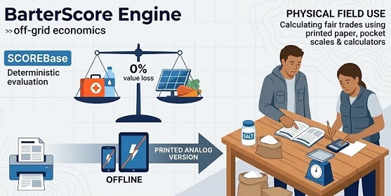

# BarterScore Engine (v1.1.0)

**A Local-First library for Collapse Informatics and Off-Grid Economics.**
*(Uma biblioteca Local-First para Informática do Colapso e Economia Off-Grid.)*

> **Idioma:**
> [**English (en-US)**](../README.md) · [**Português (pt-BR)**](./README.pt-BR.md) · [**Español (es-ES)**](./README.es-ES.md) · [**Français (fr-FR)**](./README.fr-FR.md) · [**Русский (ru-RU)**](./README.ru-RU.md) · [**Kiswahili (sw-KE)**](./README.sw-KE.md) · [**العربية (ar-SA)**](./README.ar-SA.md) · [**简体中文 (zh-Hans)**](./README.zh-Hans.md) · [**Manual Analógico (`OFFLINE_MANUAL.pt-BR.md`)**](./OFFLINE_MANUAL.pt-BR.md)

---
<p align="center">
  
</p>

O **BarterScore Engine** é um motor matemático determinístico, multiplataforma, sem dependências externas e 100% *offline-first*, projetado para avaliar cientificamente o valor físico, nutricional e funcional de itens essenciais e serviços humanos especializados para escambo em cenários de ruptura logística, crises humanitárias e colapso civil.

Licenciado sob a [**Apache License 2.0**](https://www.apache.org/licenses/LICENSE-2.0), todo o sistema é escrito em **Vanilla JavaScript puro (ES6+ UMD)** e **HTML5/CSS3** nativos, funcionando de maneira idêntica sob o protocolo local `file://` (via duplo clique, sem exigir Node.js, servidores web ou internet), CommonJS (`module.exports`) e ES Modules.

---

## Sumário

1. [Princípios Arquiteturais](#1-princípios-arquiteturais)
2. [A Fórmula Matemática Oficial](#2-a-fórmula-matemática-oficial)
3. [Metodologia Científica, Rubrica de Calibração e Fontes Oficiais (1 Clique + Auditoria Offline)](#3-metodologia-científica-rubrica-de-calibração-e-fontes-oficiais-1-clique--auditoria-offline)
4. [Contrato de Schema e Padronização Científica](#4-contrato-de-schema-e-padronização-científica)
5. [Execução Offline em 1 Clique, Impressão Física e Estrutura do Repositório](#5-execução-offline-em-1-clique-impressão-física-e-estrutura-do-repositório)
6. [Guia de Integração para Desenvolvedores e Referência da API](#6-guia-de-integração-para-desenvolvedores-e-referência-da-api)
7. [Como Adicionar o Item 129+ ou um Novo Idioma](#7-como-adicionar-o-item-129-ou-um-novo-idioma)
8. [Licença e Governança](#8-licença-e-governança)

---

## 1. Princípios Arquiteturais

- **Zero Dependências em Tempo de Execução (`file://` First):** Todos os módulos em `src/`, `data/` e `locales/` utilizam o padrão UMD híbrido que expõe `window.BarterCore` para execução local no navegador sem bloqueios de CORS, além de suportar `module.exports`.
- **Desacoplamento Total (Física vs. Idioma):** A física e a matemática dos itens ficam isoladas em `data/items_core.js` com identificadores semânticos em `snake_case`. As traduções técnicas ficam isoladas em `locales/[lang].js` seguindo a norma [**IETF BCP 47 / RFC 5646**](https://www.rfc-editor.org/info/bcp47) (`en-US`, `pt-BR`, `es-ES`, `fr-FR`, `ru-RU`, `sw-KE`, `ar-SA`, `zh-Hans`) com *Fallback* automático em três níveis:
  ```text
  Idioma Selecionado  ───►  en-US (Base Canônica)  ───►  ID Técnico Semântico
  ```
- **Zero Marcas Comerciais:** É estritamente proibido o uso de marcas comerciais. Todos os itens são normalizados por **Unidade Atômica de Consumo** (`1 comprimido`, `1 pilha`, `1 rolo`, `1 frasco 100ml`, `1 pacote 1000g`) usando nomenclatura [**OMS/INN**](https://www.who.int/teams/health-product-and-policy-standards/inn) ([**DCB/ANVISA**](https://www.gov.br/anvisa/pt-br/assuntos/farmacopeia/dcb) no Brasil) para fármacos, [**IEC 60086 / IEC 61960**](https://webstore.iec.ch/en/publication/603) para baterias e [**Codex Alimentarius (FAO/OMS)**](https://www.fao.org/fao-who-codexalimentarius/) / [**TBCA-USP**](https://www.tbca.net.br/) para alimentos.

---

## 2. A Fórmula Matemática Oficial

### 2.1. Índice Nutricional (`IN`)
Para itens não alimentares (`is_food: false`), `IN = 1.0`. Para alimentos calóricos (`is_food: true`), o índice pondera a distribuição calórica de macronutrientes e a densidade de micronutrientes críticos, limitado por `Clamp` ao intervalo `[0.5, 2.5]`:

```text
MacroFactor = (pct_kcal_protein × 1.5) + (pct_kcal_fat × 1.0) - (pct_kcal_added_sugar × 1.2)
MicroFactor = (+0.3 se high_vit_c) + (+0.2 se high_sodium_potassium) + (+0.2 se high_calcium_iron)
IN          = Clamp(1.0 + MacroFactor + MicroFactor, 0.5, 2.5)
```

### 2.2. Score Base (`ScoreBase`) e Depreciação em Tempo Real
Equilibra a energia calórica ou a Base de Energia Equivalente (`E`) contra a penalidade gravimétrica e volumétrica de transporte (`P + Vol + 0.1`), a longevidade logarítmica na base 10 (`log₁₀(V + 1)`), o custo de preparo (`CP`), o impacto psicológico (`FP`) e a resistência física da embalagem (`Frag`):

```text
ScoreBase = ( (E × IN) / (P + Vol + 0.1) ) × log₁₀(V + 1) × CP × FP × Frag
```

- **Depreciação em Tempo Real:** Quando `current_lifecycle_remaining` (ou `offerRemainingDays`) é informado em tempo real, ele substitui a validade nominal `lifecycle_units` (`V`). Se `V ≤ 0`, o item encontra-se vencido/inutilizado e `ScoreBase = 0`.

### 2.3. Modificador de Contexto Externo (`MEC`) e Score Final

```text
ScoreFinal = ScoreBase × MEC
```

- **`acute_collapse` (Colapso Agudo):** A categoria `cat_store_of_value` sofre penalização para **`0.01x`**, enquanto água potável, hemostáticos, antibióticos sistêmicos e rações prontas para consumo recebem multiplicadores de escassez aguda.
- **`economic_reconstruction` (Reconstrução Econômica):** A categoria `cat_store_of_value` valoriza-se em **`5.0x`**, juntamente com ferramentas manuais duráveis, sementes de polinização aberta, painéis solares e rádios transceptores VHF/UHF.

### 2.4. Taxa de Escambo e Alerta de Indivisibilidade (`calculateTrade`)
Dado um item ofertado `A` (quantidade `Q_A`) e um item solicitado `B`:

```text
Q_B_exata = ( ScoreFinal(A) × Q_A ) / ScoreFinal(B)
```

Caso o item `B` seja indivisível (`is_divisible: false`), o motor arredonda a quantidade recomendada para o inteiro mais próximo (`Q_B_rec = max(1, round(Q_B_exata))`) e emite o alerta estruturado `trade_imbalance` / `tradeImbalanceWarning`, indicando o percentual exato de excedente ou déficit de valor e sugerindo a compensação (troco) com itens divisíveis de alta liquidez (como sal iodado em gramas ou comprimidos avulsos).

---

## 3. Metodologia Científica, Rubrica de Calibração e Fontes Oficiais (1 Clique + Auditoria Offline)

Por que cada item do catálogo recebe exatamente aquela pontuação, o que significa fisicamente **`1 Ponto BarterScore (1 pt)`** e por que um Item B tem o dobro (`2x`) de pontos de um Item A? Como nenhum órgão governamental publica uma equação unificada que compare diretamente *1 kg de arroz* com *1 cápsula de amoxicilina* ou *1 célula de íon-lítio 18650*, o **BarterScore Engine** combina **registros empíricos oficiais verificados** (arquivados localmente para consulta sem internet em [`audit_sources/`](../audit_sources/OFFLINE_AUDIT_DOSSIER.md) e com links diretos abaixo) com **rubricas de engenharia em degraus decimais explicitamente justificadas**.

### 3.0. O Significado Físico de `1 Ponto BarterScore (1 pt)` e Por Que um Item Vale `2x` Outro
Pela análise dimensional da equação `ScoreBase = ((E × IN) / (P + Vol + 0.1)) × log₁₀(V + 1) × CP × FP × Frag`:
- **Definição Física de `1.0000 pt`:** **`1 Ponto BarterScore`** equivale exatamente a **1 Quilocaloria Efetiva de Sobrevivência (`E × IN = 1`) por unidade de Carga Logística Gravimétrica-Volumétrica (`P + Vol + 0.1 = 1.0`), sustentada por 1 Década Logarítmica de Validade (`V = 9 dias` → `log₁₀(10) = 1.0`) em prontidão operacional neutra (`CP = 1.0`, `FP = 1.0`, `Frag = 1.0`)**.
- **Por que o Item B recebe `2.0x` os pontos do Item A:** Mantendo as demais variáveis constantes, a pontuação de um item dobra quando: **(1)** ele fornece o dobro (`2×`) de quilocalorias metabolizáveis (`kcal`) ou o dobro de economia metabólica `EEB` (`E`); **(2)** ele entrega a mesma utilidade na metade da carga combinada de peso e volume (`P + Vol + 0.1`); **(3)** sua validade eleva-se ao quadrado na escala logarítmica de base 10 (por exemplo, `1.000 dias` [`log₁₀ ≈ 3,0`] vs. `31 dias` [`log₁₀ ≈ 1,5`]); ou **(4)** o produto de prontidão operacional (`CP × FP × Frag`) é duas vezes maior.

### 3.1. Fontes Científicas, Regulatórias e Governamentais Oficiais (Snapshot Offline em `audit_sources/` + Links Diretos)
> **Auditoria 100% Offline (`audit_sources/`):** Todas as consultas das fontes, códigos **USDA FDC ID**, códigos **ATC da OMS** e formulações oficiais estão salvos localmente dentro do documento [`audit_sources/OFFLINE_AUDIT_DOSSIER.md`](../audit_sources/OFFLINE_AUDIT_DOSSIER.md) e no módulo UMD [`audit_sources/offline_sources_registry.js`](../audit_sources/offline_sources_registry.js) (`window.BarterCore.AuditSources`), permitindo auditar toda a base via protocolo `file://` sem depender de internet.
>
> **Nota de Escopo (Exemplos Representativos vs. Matriz Completa dos 128 Itens):** Para manter este `README` conciso e didático, os itens citados abaixo são **exemplos representativos** de cada domínio científico. A matriz de rastreabilidade e auditoria individual completa de todos os **128 itens do catálogo (`001` a `128`: 100 mercadorias físicas + 28 serviços humanos essenciais)** encontra-se integralmente documentada em [`audit_sources/OFFLINE_AUDIT_DOSSIER.md`](../audit_sources/OFFLINE_AUDIT_DOSSIER.md).

1. **Densidade Calórica e Macronutrientes (`E_alimento`, `IN`) — Códigos de Registro Específicos USDA FDC / TBCA / TACO:**
   - Extraídos diretamente do [**USDA FoodData Central (SR Legacy)**](https://fdc.nal.usda.gov/), da [**TBCA — USP/FoRC**](https://www.tbca.net.br/), da [**TACO 4ª Edição — UNICAMP (PDF)**](https://www.cfn.org.br/wp-content/uploads/2017/03/taco_4_edicao_ampliada_e_revisada.pdf) e do [**Codex Alimentarius (FAO/OMS)**](https://www.fao.org/fao-who-codexalimentarius/). Registros específicos auditados:
     - **Arroz Branco Polido Cru (`rice_white_polished_raw_1000g`):** [**USDA FDC ID 169756 / NDB 20444**](https://fdc.nal.usda.gov/food-details/169756/nutrients) (`365 kcal/100g` → `3.650 kcal/1000g`, proteína `7,13 g/100g`, lipídios `0,66 g/100g`).
     - **Feijão Seco Cru (`beans_common_dry_1000g`):** [**USDA FDC ID 173734 / NDB 16014**](https://fdc.nal.usda.gov/food-details/173734/nutrients) & [**TBCA C0113A**](https://www.tbca.net.br/) (`329 kcal/100g` média composta → `3.290 kcal/1000g`, proteína `24,5% kcal`, alto teor de Fe e K).
     - **Mel Puro, Açúcar Refinado e Óleo Vegetal:** [**FDC ID 169640**](https://fdc.nal.usda.gov/food-details/169640/nutrients) (`304 kcal/100g`), [**FDC ID 169655**](https://fdc.nal.usda.gov/food-details/169655/nutrients) (`387 kcal/100g`) e [**FDC ID 171411**](https://fdc.nal.usda.gov/food-details/171411/nutrients) (`884 kcal/100g`).
2. **Seleção Farmacológica, Códigos ATC, SRO e Trauma (`cat_pharma_essential`, `cat_trauma_hygiene`):**
   - Baseada na [**23ª Lista Modelo de Medicamentos Essenciais da OMS (`WHO/MHP/HPS/EML/2023.02`)**](https://iris.who.int/handle/10665/371090) (Amoxicilina 500mg `ATC: J01CA04` Grupo Access; Ciprofloxacino 500mg `ATC: J01MA02` Grupo Watch; Azitromicina 500mg `ATC: J01FA10` Grupo Watch; Paracetamol 500mg `ATC: N02BE01`), na especificação oficial de [**Sais de Reidratação Oral de Baixa Osmolaridade da OMS/UNICEF (`Documento WHO/FCH/CAH/06.1`: `20,5 g/L`, `245 mOsm/L`)**](https://iris.who.int/handle/10665/69227), no [**WHO IEHK 2017**](https://www.who.int/emergencies/emergency-health-kits/interagency-emergency-health-kit-2017), nas diretrizes [**CoTCCC / US DoD TCCC**](https://deployedmedicine.com/market/31) e no [**Guia Oficial do US FDA (Dezembro de 2001) sobre Iodeto de Potássio (`130 mg` para Bloqueio Tireoidiano Adulto)**](https://www.fda.gov/drugs/bioterrorism-and-drug-preparedness/frequently-asked-questions-potassium-iodide-ki).
3. **Desinfecção de Água, Padrão Sphere WASH 2.1 e Combustível de Cocção (`CP`, `cat_water_fire_shelter`):**
   - Baseados no [**Manual Sphere (Edição 2018, Padrão WASH 2.1: `15 L/pessoa/dia` necessidade básica total; `2,5–3,0 L/dia` ingestão de sobrevivência; `3–6 L/dia` cocção de alimentos)**](https://spherestandards.org/handbook/editions/) e nas [**Diretrizes da OMS para Qualidade da Água Potável (`ISBN 978-92-4-154995-0`: 1 pastilha de `67 mg` de NaDCC trata `20 Litros` de água clara em `30 min`)**](https://www.who.int/publications/i/item/9789241549950).
4. **Validade Lacrada (`V`) e Durabilidade de Embalagem (`Frag`):**
   - Baseados nos estudos do [**US Army DEVCOM Soldier Center (Natick)**](https://www.army.mil/devcom-sc), nas diretrizes [**USDA FSIS Shelf-Stable Food Safety**](https://www.fsis.usda.gov/food-safety/safe-food-handling-and-preparation/food-safety-basics/shelf-stable-food), nos guias da [**FEMA / Ready.gov**](https://www.ready.gov/food) e no programa [**FDA / DoD Shelf-Life Extension Program (SLEP)**](https://www.fda.gov/emergency-preparedness-and-response/mcm-legal-regulatory-and-policy-framework/expiration-dating-extension).
5. **Serviços Humanos Essenciais, Procedimentos Clínicos, TI Off-Grid, Instrução e Trabalho Técnico (`cat_essential_services`, Itens `101–128`):**
   - Baseados no [**Manual OMS IMEESC (Cuidados Cirúrgicos Essenciais e de Emergência)**](https://www.who.int/Specify/emergencies/surgical-care), no [**Guia OMS/UNFPA/UNICEF IMPAC (Complicações na Gravidez e Parto, ISBN 978-92-4-156549-3)**](https://www.who.int/publications/i/item/9789241565493), na [**Classificação Internacional de Ocupações OIT ISCO-08 & Norma Ergonomia Metabólica ISO 8996**](https://ilostat.ilo.org/methods/concepts-and-definitions/classification-occupation/), nos [**Manuais Veterinários e de Sementes da FAO**](https://www.fao.org/agriculture/crops/thematic-sitemap/theme/seeds-pgr/seed-sys/security/en/), nas [**Normas de Manutenção de Campo IEEE / IEC / ETSI**](https://www.itu.int/en/ITU-D/Emergency-Telecommunications/), nas normas [**IEEE 802.11s / ISO/IEC 27037 / IPC-7711/7721 / IEC 61131-3 (TI Off-Grid e Microeletrônica)**](https://standards.ieee.org/ieee/802.11s/4570/) e nas normas [**UNESCO ISCED / OMS-CICV BEC / ISO 17100 (Instrução Técnica e Tradução)**](https://uis.unesco.org/en/topic/international-standard-classification-education-isced).
   - *Mapeamento Físico de Serviços Intangíveis:* Todos os 28 serviços (`is_food: false`, `is_divisible: false`, `sub_units: 1`, `unit_measure: 'un'`) mapeiam `weight_kg (P)` (`0,08–0,30 kg`) e `volume_liters (Vol)` (`0,10–0,35 L`) para o **Consumo e Desgaste Físico Marginal por Procedimento** (representando apenas os insumos consumíveis e o desgaste proporcional de instrumentos gastos por intervenção individual, visto que o técnico ou médico retém sua maleta permanente, evitando tanto a penalização excessiva da maleta completa quanto a inflação assintótica de `0,001 kg`), `lifecycle_units (V)` (`7–3.650 dias`) para o **Intervalo de Durabilidade / Recorrência do Desfecho do Serviço**, e `energy_or_utility_base (E)` (`5.200–38.000 EEB`) para o **Déficit Calórico Biológico Evitado + Trabalho Técnico Poupado**. Por padrão, `calculateChangeOptions()` exclui `cat_essential_services` das sugestões automáticas de troco fracionário.

#### Diretório Completo de Verificação em 1 Clique (Com Códigos de Documento e IDs de Registro Exatos)

| Domínio / Escopo | Órgão e Código Exato do Documento / Registro | Link Direto para Comprovação em 1 Clique |
| :--- | :--- | :--- |
| **Dossiê de Auditoria Local Offline** | Pasta de Registro Offline (`audit_sources/`) | [`../audit_sources/OFFLINE_AUDIT_DOSSIER.md`](../audit_sources/OFFLINE_AUDIT_DOSSIER.md) |
| **Nutrição: Arroz Branco (`365 kcal/100g`)** | USDA FoodData Central — `FDC ID: 169756` (`NDB 20444`) | [https://fdc.nal.usda.gov/food-details/169756/nutrients](https://fdc.nal.usda.gov/food-details/169756/nutrients) |
| **Nutrição: Feijão Seco (`329–341 kcal/100g`)** | USDA FoodData Central — `FDC ID: 173734` (`NDB 16014`) & TBCA `C0113A` | [https://fdc.nal.usda.gov/food-details/173734/nutrients](https://fdc.nal.usda.gov/food-details/173734/nutrients) |
| **Nutrição: Mel, Açúcar e Óleo** | USDA FDC IDs `169640`, `169655` e `171411` | [https://fdc.nal.usda.gov/food-details/169640/nutrients](https://fdc.nal.usda.gov/food-details/169640/nutrients) |
| **Nutrição: Tabelas Nacionais (Brasil)** | TBCA (USP/FoRC) & TACO 4ª Edição PDF (UNICAMP) | [https://www.tbca.net.br/](https://www.tbca.net.br/) · [https://www.cfn.org.br/.../taco_4_edicao_ampliada_e_revisada.pdf](https://www.cfn.org.br/wp-content/uploads/2017/03/taco_4_edicao_ampliada_e_revisada.pdf) |
| **Padrões Internacionais de Alimentos** | FAO/WHO Codex Alimentarius Commission | [https://www.fao.org/fao-who-codexalimentarius/](https://www.fao.org/fao-who-codexalimentarius/) |
| **Medicamentos Essenciais (`J01CA04`, etc.)** | OMS 23ª Lista EML (`WHO/MHP/HPS/EML/2023.02`) | [https://iris.who.int/handle/10665/371090](https://iris.who.int/handle/10665/371090) |
| **Sais de Reidratação Oral (`20,5 g/L`)** | OMS / UNICEF SRO Baixa Osmolaridade (`WHO/FCH/CAH/06.1`) | [https://iris.who.int/handle/10665/69227](https://iris.who.int/handle/10665/69227) |
| **Princípios Ativos Farmacêuticos** | OMS — International Nonproprietary Names (INN) | [https://www.who.int/teams/health-product-and-policy-standards/inn](https://www.who.int/teams/health-product-and-policy-standards/inn) |
| **Kits Médicos de Emergência Humanitária** | OMS / ACNUR / UNICEF — IEHK 2017 | [https://www.who.int/emergencies/emergency-health-kits/interagency-emergency-health-kit-2017](https://www.who.int/emergencies/emergency-health-kits/interagency-emergency-health-kit-2017) |
| **Trauma Arterial Pré-Hospitalar** | CoTCCC / US DoD — Diretrizes TCCC | [https://deployedmedicine.com/market/31](https://deployedmedicine.com/market/31) |
| **Bloqueio Tireoidiano Radiológico** | US FDA Guia Dez 2001 — Potassium Iodide (`130 mg`) | [https://www.fda.gov/drugs/bioterrorism-and-drug-preparedness/frequently-asked-questions-potassium-iodide-ki](https://www.fda.gov/drugs/bioterrorism-and-drug-preparedness/frequently-asked-questions-potassium-iodide-ki) |
| **Nomenclatura Local `en-US`** | United States Pharmacopeia (USP) & FDA Orange Book | [https://www.usp.org/](https://www.usp.org/) · [https://www.accessdata.fda.gov/scripts/cder/ob/](https://www.accessdata.fda.gov/scripts/cder/ob/) |
| **Nomenclatura Local `pt-BR`** | DCB / ANVISA (Denominação Comum Brasileira) | [https://www.gov.br/anvisa/pt-br/assuntos/farmacopeia/dcb](https://www.gov.br/anvisa/pt-br/assuntos/farmacopeia/dcb) |
| **Nomenclatura Local `es-ES`** | DOE / CIMA AEMPS & BOE `BOE-A-1967-16485` (CAE) | [https://cima.aemps.es/](https://cima.aemps.es/) · [https://www.boe.es/buscar/act.php?id=BOE-A-1967-16485](https://www.boe.es/buscar/act.php?id=BOE-A-1967-16485) |
| **Nomenclatura Local `fr-FR`** | DCI / ANSM (Pharmacopée Française) & ANSES Table Ciqual | [https://ansm.sante.fr/documents/reference/pharmacopee](https://ansm.sante.fr/documents/reference/pharmacopee) · [https://ciqual.anses.fr/](https://ciqual.anses.fr/) |
| **Nomenclatura Local `ru-RU`** | МНН / ГРЛС Минздрава РФ (ГФ РФ XV) & Росстандарт (ГОСТ) | [https://grls.rosminzdrav.ru/](https://grls.rosminzdrav.ru/) · [https://protect.gost.ru/](https://protect.gost.ru/) |
| **Nomenclatura Local `sw-KE`** | KEML / PPB Kenya (Pharmacy and Poisons Board) & KEBS / KFCT | [https://web.pharmacyboardkenya.org/](https://web.pharmacyboardkenya.org/) · [https://www.kebs.org/](https://www.kebs.org/) |
| **Nomenclatura Local `ar-SA`** | SFDA (Saudi Food & Drug Authority) & Normas SASO / GSO | [https://www.sfda.gov.sa/](https://www.sfda.gov.sa/) · [https://www.saso.gov.sa/](https://www.saso.gov.sa/) |
| **Nomenclatura Local `zh-Hans`** | Farmacopeia Chinesa (ChP) & Normas Nacionais GB (SAMR) | [https://www.chp.org.cn/](https://www.chp.org.cn/) · [https://openstd.samr.gov.cn/](https://openstd.samr.gov.cn/) |
| **Água e Desinfecção NaDCC (`67mg/20L`)** | Sphere WASH Std 2.1 (`15L/dia`) & OMS GDWQ `978-92-4-154995-0` | [https://spherestandards.org/handbook/editions/](https://spherestandards.org/handbook/editions/) · [https://www.who.int/publications/i/item/9789241549950](https://www.who.int/publications/i/item/9789241549950) |
| **Validade (`V`) e Embalagens (`Frag`)** | USDA FSIS Shelf-Stable, FEMA Ready.gov & FDA SLEP | [https://www.fsis.usda.gov/.../shelf-stable-food](https://www.fsis.usda.gov/food-safety/safe-food-handling-and-preparation/food-safety-basics/shelf-stable-food) · [https://www.fda.gov/.../expiration-dating-extension](https://www.fda.gov/emergency-preparedness-and-response/mcm-legal-regulatory-and-policy-framework/expiration-dating-extension) |
| **Pilhas e Baterias (`LR6`, `LR03`, `INR18650`)** | IEC 60086-2 (Primárias) & IEC 61960-3 (Lítio Secundárias) | [https://webstore.iec.ch/en/publication/603](https://webstore.iec.ch/en/publication/603) |
| **Respiradores Particulados (`N95 / PFF2`)** | CDC / NIOSH `42 CFR Part 84` | [https://www.cdc.gov/niosh/npptl/topics/respirators/disp_part/n95list1.html](https://www.cdc.gov/niosh/npptl/topics/respirators/disp_part/n95list1.html) |
| **Metais Nobres (`999.0 Fine` Ouro/Prata)** | LBMA Good Delivery Assay Specifications | [https://www.lbma.org.uk/good-delivery/about-good-delivery](https://www.lbma.org.uk/good-delivery/about-good-delivery) |
| **Cirurgia de Emergência e Obstetrícia** | OMS IMEESC & OMS/UNFPA/UNICEF IMPAC (`978-92-4-156549-3`) | [https://www.who.int/publications/i/item/9789241565493](https://www.who.int/publications/i/item/9789241565493) |
| **Trabalho Técnico e Ergonomia Metabólica** | OIT ISCO-08 & ISO 8996 (Taxa Metabólica Ocupacional) | [https://ilostat.ilo.org/methods/concepts-and-definitions/classification-occupation/](https://ilostat.ilo.org/methods/concepts-and-definitions/classification-occupation/) · [https://www.iso.org/standard/74443.html](https://www.iso.org/standard/74443.html) |
| **TI Off-Grid, Recuperação de Dados e PCB** | IEEE 802.11s, ISO/IEC 27037, IPC-7711/7721 & IEC 61131-3 | [https://standards.ieee.org/ieee/802.11s/4570/](https://standards.ieee.org/ieee/802.11s/4570/) · [https://www.iso.org/standard/44381.html](https://www.iso.org/standard/44381.html) |
| **Instrução Técnica, Pedagogia e Tradução** | UNESCO ISCED, OMS/CICV BEC & ISO 17100:2015 | [https://uis.unesco.org/en/topic/international-standard-classification-education-isced](https://uis.unesco.org/en/topic/international-standard-classification-education-isced) · [https://www.iso.org/standard/59149.html](https://www.iso.org/standard/59149.html) |
| **Relatórios de Conflitos e Cercos Urbanos** | CICV Publicação `4249` & OMS Ucrânia | [https://www.icrc.org/en/publication/4249-urban-services-during-protracted-armed-conflict](https://www.icrc.org/en/publication/4249-urban-services-during-protracted-armed-conflict) · [https://www.who.int/emergencies/situations/ukraine-emergency](https://www.who.int/emergencies/situations/ukraine-emergency) |

### 3.2. Heurísticas de Engenharia e Rubrica de Degraus Decimais (Sem Fonte Externa — Justificadas por Projeto)
Onde a literatura oficial separa nutrição (`kcal`), medicina (desfecho clínico) e logística (`kg/L`) em silos incompatíveis, este motor introduz quatro heurísticas originais que não provêm de tabela governamental externa e possuem a seguinte justificativa formal:

1. **Base de Energia Equivalente (`EEB` no intervalo `[500, 50000]`) para Itens Não Alimentares:**
   - *Justificativa da Criação:* Não existe unidade física direta que converta um antibiótico ou uma ferramenta em calorias. O `EEB` foi criado sob o princípio termodinâmico de **Gasto Metabólico Poupado / Déficit Biológico Evitado** (em `kcal` equivalentes). Exemplo: uma infecção bacteriana sistêmica (febre de **39,5 °C** por 7 dias) ou uma diarreia aguda desidratante drena de **3.500 a 15.000+ kcal** das reservas basais e ameaça a vida; cortar lenha, filtrar água ou acender fogo manualmente sem ferramentas consome de **500 a 3.000+ kcal** extras de esforço físico e exposição térmica.
2. **Regra de Insumos Metabólicos e Funcionais Não-Calóricos (`is_food: false` para Água, Sal, Café, Chá, Vinagre, Bicarbonato, Tabaco e Etanol Potável):**
   - *Justificativa da Criação:* Nove itens de consumo humano nas categorias `cat_staple_foods` e `cat_spices_morale` (`water_potable_sealed_1000ml`, `salt_sodium_chloride_iodized_1000g`, `coffee_roasted_ground_vacuum_500g`, `coffee_instant_soluble_granules_50g`, `vinegar_acetic_acid_4pct_750ml`, `sodium_bicarbonate_pure_100g`, `tea_camellia_sinensis_dry_50g`, `tobacco_cigarette_filtered_unit` e `alcohol_ethanol_potable_40pct_500ml`) são intencionalmente configurados com **`is_food: false`** (`IN = 1.0`) e avaliados via **`EEB`** em vez de `kcal` dietéticas. Nas tabelas USDA/TACO, água pura, sal e bicarbonato possuem **`0 kcal`**, e café, chá e vinagre possuem `< 20 kcal/100g`; avaliá-los como alimentos calóricos geraria `ScoreBase = 0 pts` para água potável e eletrólitos vitais. Por sua vez, o etanol 40% possui calorias alcoólicas hepatotóxicas/não-nutritivas cujo valor real em crise reside na antissepsia, solvência e liquidez cambial.
3. **Constante de Amortecimento Gravimétrico (`ε = 0.1` em `P + Vol + 0.1`), Pesos do `IN` e Escala Logarítmica (`log₁₀(V + 1)`):**
   - *Justificativa da Criação:* O termo `ε = 0.1` evita divisão por zero ou explosão assintótica quando o peso `P` tende a `0,001 kg` (1 cápsula ou 1 pastilha NaDCC), estabilizando o ganho máximo de portabilidade em `~9,8×`. Os pesos do `IN` (`+1.5` proteína, `+1.0` lipídios, `-1.2` açúcar adicionado, limitados a `[0.5, 2.5]`) diferenciam nutrientes plásticos/estruturais de calorias glicêmicas vazias, enquanto `log₁₀(V + 1)` comprime a diferença entre 100 anos e 1 ano em um prêmio de durabilidade realista (`1,78×` em vez de `100×`).
4. **Rubrica de Calibração por Degraus Decimais Exatos (`CP`, `FP`, `Frag` e `MEC`):**
   - *Justificativa da Criação:* Cada degrau decimal dentro da faixa de um parâmetro obedece a um critério operacional estrito (consulte a tabela completa no dossiê offline [`audit_sources/OFFLINE_AUDIT_DOSSIER.md`](../audit_sources/OFFLINE_AUDIT_DOSSIER.md)):

| Parâmetro | Faixa | Rubrica de Degraus Decimais (Por Que Cada Valor Exato É Atribuído) |
| :--- | :---: | :--- |
| **`energy_or_utility_base` (`E`)** | `> 0` | **Alimentos:** Total exato de `kcal` do pacote atômico (`FDC-169756` arroz `3.650 kcal`, `FDC-173734`/`TBCA` feijão `3.290 kcal`).<br>**Não Alimentos (`EEB`):**<br>• `500 – 3.000`: Consumíveis de uso único (`tobacco_cigarette_filtered_unit` `650`, `paracetamol_500mg_tablet` `1.600`, `gauze_sterile_compress_7_5cm_unit` `2.200`, `water_purification_nadcc_tablet_unit` `2.600`).<br>• `3.000 – 10.000`: Antibióticos sistêmicos por cápsula (`amoxicillin_500mg_capsule` `4.200`, `ciprofloxacin_500mg_tablet` `5.000`), suturas (`8.200`), isqueiro de butano (`7.500`).<br>• `10.000 – 25.000`: Torniquete arterial (`tourniquet_tactical_arterial_unit` `18.500`), célula `INR18650` (`12.500`), pederneira de ferrocério (`16.000`), 1 L de hipoclorito (`14.500`).<br>• `25.000 – 50.000`: Bens de capital duráveis multianuais (`filter_water_hollow_fiber_0_1micron_unit` `32.000`, `knife_fixed_blade_carbon_steel_fulltang` `28.000`, `panel_solar_monocrystalline_usb_5v_10w_unit` `38.000`, `radio_transceiver_vhf_uhf_dualband_unit` `42.000`, `gold_bullion_999_fine_fractional_1g` `50.000`). |
| **`cost_of_prep` (`CP`)** | `0.50 – 1.00` | • **`1.00`**: Zero preparo (alimento enlatado pronto, comprimido oral, água potável, ferramenta pronta).<br>• **`0.90 – 0.96`**: Dissolução a frio em **menos de 2 min**, zero combustível (`oral_rehydration_salts_who_sachet_27_9g`, `milk_powder_whole_400g`).<br>• **`0.80 – 0.88`**: Hidratação rápida ou aquecimento leve de **2 a 5 min** (`oats_rolled_whole_500g`, `coffee_roasted_ground_vacuum_500g`).<br>• **`0.72 – 0.78`**: Cozimento rápido de **8 a 12 min** (`lentils_dry_raw_500g`, `pasta_wheat_dry_500g`).<br>• **`0.65 – 0.68`**: Fervura padrão de **15 a 20 min** + proporção **2:1** de água (`rice_white_polished_raw_1000g`, `meat_bovine_cured_salted_500g`).<br>• **`0.50 – 0.58`**: Fervura pesada de **45 a 60 min** + proporção **3:1** de água (`beans_common_dry_1000g`, `chickpeas_dry_raw_500g`). |
| **`psychological_factor` (`FP`)** | `1.00 – 2.50` | • **`1.20 – 1.30`**: Insumos utilitários brutos (`gelatin_unflavored_powder_50g`, `flour_wheat_enriched_1000g`).<br>• **`1.35 – 1.45`**: Alimentos básicos de saciedade familiar (`rice_white_polished_raw_1000g`, `beans_common_dry_1000g`).<br>• **`1.50 – 1.85`**: Dignidade higiênica, analgesia e conforto moral (`fish_sardine_canned_oil_125g`, `honey_bee_pure_500g`).<br>• **`1.90 – 2.25`**: Mitigação de abstinência neuroquímica com alta liquidez em cercos (`coffee_roasted_ground_vacuum_500g`, `chocolate_dark_cocoa_60pct_100g`).<br>• **`2.30 – 2.40`**: Anti-infecciosos críticos e desinfecção hídrica (`amoxicillin_500mg_capsule`, `water_purification_nadcc_tablet_unit`).<br>• **`2.45 – 2.50`**: Teto absoluto de preservação imediata da vida (`tourniquet_tactical_arterial_unit`, `infant_formula_powder_stage1_400g`, `filter_water_hollow_fiber_0_1micron_unit`). |
| **`fragility_index` (`Frag`)** | `0.70 – 1.20` | • **`0.75 – 0.80`**: Papel/papelão hidrofílico exposto ou óptica frágil (`paper_toilet_cellulose_roll_30m`, `biscuit_wheat_salted_dry_400g`).<br>• **`0.85 – 0.90`**: Pacote polimérico flexível ou garrafa líquida (`pasta_wheat_dry_500g`, `oil_vegetable_refined_900ml`).<br>• **`0.95 – 1.05`**: Pacote espesso selado, frasco PEAD ou blíster farmacêutico (`rice_white_polished_raw_1000g`, `amoxicillin_500mg_capsule` `1.05`).<br>• **`1.10 – 1.18`**: Lata metálica hermética, blíster laminado ou multiferramenta em aço (`fish_sardine_canned_oil_125g` `1.15`).<br>• **`1.20`**: Liga metálica sólida ou metal nobre maciço indestrutível (`tourniquet_tactical_arterial_unit`, `gold_bullion_999_fine_fractional_1g`, `silver_bullion_999_fine_1_troy_oz_31_1g`). |

### 3.3. Lições Empíricas de Guerras e Cercos Urbanos Recentes Catalogadas no Motor
O catálogo de 128 itens e os modificadores de contexto (`MEC`) refletem diretamente as lições logísticas documentadas em conflitos modernos:
- **Cerco de Sarajevo (1992–1996, Guerra da Bósnia):** Documentou a desmonetização aguda do ouro e das joias durante cercos urbanos fechados (`cat_store_of_value` cai para **`0.01x`** em `acute_collapse` e sobe para **`5.0x`** apenas em `economic_reconstruction`), enquanto **isqueiros de butano**, **cigarros avulsos**, **café**, **sal** e **álcool antisséptico** operavam como moedas fracionárias de altíssima liquidez.
- **Guerra da Ucrânia (2022–Presente — Mariupol, Bakhmut e Apagões de Inverno — [Relatórios de Emergência da OMS](https://www.who.int/emergencies/situations/ukraine-emergency)):** Comprovou que a sobrevivência civil moderna sob bombardeio e colapso elétrico (*grid-down*) depende criticamente de **microenergia DC e comunicação descentralizada** (**baterias Li-Ion 18650**, **painéis solares USB 5V 10W**, **rádios VHF/UHF dual-band**), **trauma tático civil (TCCC)** (**torniquetes arteriais**, **suturas de nylon 3-0**) e **bloqueio tireoidiano radiológico** (**iodeto de potássio 130mg**).
- **Crises Hídricas e Epidemias de Cólera (Síria, Iêmen, Gaza, Sudão — [Relatórios de Cercos Urbanos do CICV](https://www.icrc.org/en/publication/4249-urban-services-during-protracted-armed-conflict) e [Diretrizes WASH da OMS](https://www.who.int/publications/i/item/9789241549950)):** Demonstraram que, quando o bombeamento elétrico para e não há combustível para ferver água, a **desinfecção química a frio** (**pastilhas NaDCC**, **hipoclorito de sódio 2,5%**), os **filtros de fibra oca de 0,1 mícron**, os **Sais de Reidratação Oral (SRO)** e os **antibióticos contra enteropatógenos** (**ciprofloxacino**, **metronidazol**, **azitromicina**) possuem o maior valor de sobrevivência por grama nos primeiros 30 dias.

### 3.4. Exemplos de Cálculo Passo a Passo (*Worked Examples* Auditados no `data/items_core.js`)

#### Exemplo Passo a Passo A: Alimento Básico (`rice_white_polished_raw_1000g`)
- **Parâmetros de Entrada (`data/items_core.js`):**
  - `is_food`: `true`, `energy_or_utility_base (E)`: `3650` kcal, `weight_kg (P)`: `1.0` kg, `volume_liters (Vol)`: `1.18` L, `lifecycle_units (V)`: `1825` dias.
  - `cost_of_prep (CP)`: `0.65`, `psychological_factor (FP)`: `1.35`, `fragility_index (Frag)`: `1.05`.
  - Macros: `pct_kcal_protein = 0.078`, `pct_kcal_fat = 0.015`, `pct_kcal_added_sugar = 0.0`, Micros: todos `false`.
- **Passo 1 — Índice Nutricional (`IN`):**
  ```text
  MacroFactor = (0.078 × 1.5) + (0.015 × 1.0) - (0 × 1.2) = 0.117 + 0.015 = 0.132
  IN          = Clamp(1.0 + 0.132 + 0, 0.5, 2.5) = 1.132
  ```
- **Passo 2 — Score Base (`ScoreBase`):**
  ```text
  TermoDensidade   = (3650 × 1.132) / (1.0 + 1.18 + 0.1) = 4131.8 / 2.28 = 1812.192982
  TermoLongevidade = log₁₀(1825 + 1) = log₁₀(1826) = 3.26150077
  ScoreBase        = 1812.192982 × 3.26150077 × 0.65 × 1.35 × 1.05 = 5445.7582 pts
  ```
- **Passo 3 — Score Final em `acute_collapse` (`MEC`):**
  - Categoria `cat_staple_foods` (`1.25×`) × tag `high_calorie_density` (`1.30×`) → **`MEC = 1.625`**.
  ```text
  ScoreFinal       = 5445.7582 × 1.625 = 8849.3571 pts
  ```

#### Exemplo Passo a Passo B: Fármaco Essencial Não Alimentar (`amoxicillin_500mg_capsule`)
- **Parâmetros de Entrada (`data/items_core.js`):**
  - `is_food`: `false` (→ **`IN = 1.0`**), `energy_or_utility_base (E)`: `4200` EEB, `weight_kg (P)`: `0.001` kg, `volume_liters (Vol)`: `0.002` L, `lifecycle_units (V)`: `1095` dias.
  - `cost_of_prep (CP)`: `1.0`, `psychological_factor (FP)`: `2.35`, `fragility_index (Frag)`: `1.05`.
- **Passo 1 — Score Base (`ScoreBase`):**
  ```text
  TermoDensidade   = (4200 × 1.0) / (0.001 + 0.002 + 0.1) = 4200 / 0.103 = 40776.699029
  TermoLongevidade = log₁₀(1095 + 1) = log₁₀(1096) = 3.03981055
  ScoreBase        = 40776.699029 × 3.03981055 × 1.0 × 2.35 × 1.05 = 305855.1134 pts
  ```
- **Passo 2 — Score Final em `acute_collapse` (`MEC`):**
  - Categoria `cat_pharma_essential` (`1.40×`) × tag `antibiotic_systemic` (`1.70×`) → **`MEC = 2.38`**.
  ```text
  ScoreFinal       = 305855.1134 × 2.38 = 727935.1699 pts
  ```

---

## 4. Contrato de Schema e Padronização Científica

Todo item em `data/items_core.js` ou registrado via `BarterEngine.registerCustomItems([item])` é validado por `window.BarterCore.Validator.validateItem(item)`:

| Propriedade | Tipo | Restrição / Valores Permitidos |
| :--- | :--- | :--- |
| `id` | `string` | `snake_case` minúsculo (`/^[a-z][a-z0-9_]{2,120}$/`), não numérico, sem marcas comerciais |
| `category` | `string` | `cat_staple_foods`, `cat_critical_nutrition`, `cat_spices_morale`, `cat_pharma_essential`, `cat_trauma_hygiene`, `cat_water_fire_shelter`, `cat_tools_energy_comms`, `cat_store_of_value`, `cat_essential_services` |
| `is_food` | `boolean` | `true` para alimentos calóricos; `false` para itens não alimentares, fármacos, ferramentas e serviços |
| `is_divisible` | `boolean` | `true` se fracionável em `sub_units`; `false` se negociado apenas em unidades inteiras |
| `sub_units` | `number` | Inteiro `≥ 1` (`1` para itens indivisíveis; total em `g`, `ml` ou subunidades para itens divisíveis) |
| `unit_measure` | `string` | `"g"` \| `"ml"` \| `"un"` |
| `energy_or_utility_base` | `number` | `> 0` (Total real de `kcal` para alimentos; `EEB` no intervalo `[500, 50000]` para não alimentos) |
| `weight_kg` | `number` | Massa física em quilogramas (`> 0`) |
| `volume_liters` | `number` | Volume físico ocupado em litros (`≥ 0`) |
| `lifecycle_units` | `number` | Prazo de validade nominal do item lacrado, em dias (`> 0`) |
| `cost_of_prep` | `number` | Coeficiente de facilidade de preparo no intervalo `[0.5, 1.0]` |
| `psychological_factor` | `number` | Coeficiente de impacto moral e psicológico no intervalo `[1.0, 2.5]` |
| `fragility_index` | `number` | Coeficiente de resistência física da embalagem no intervalo `[0.7, 1.2]` |
| `tags` | `string[]` | Array não vazio de tags funcionais em `snake_case` |

---

## 5. Execução Offline em 1 Clique, Impressão Física e Estrutura do Repositório

Não é necessário instalar compiladores, servidores web ou possuir conexão com a internet para o uso offline:

- **Windows (7 / 10 / 11):** Dê um duplo clique em `start_windows.bat` na raiz do projeto.
- **Linux / macOS / FreeBSD / OpenBSD:** Execute `./start_unix.sh` (ou `sh ./start_unix.sh`).
- **Abertura Direta:** Dê duplo clique em `manual_generator.html` em qualquer gerenciador de arquivos desktop ou mobile.
- **Simulador Bilateral de Escambo e Resumo de Liquidação Direta:** Na interface de `manual_generator.html`, selecione o **Item Ofertado (Você Entrega)** e o **Item Solicitado (Para Receber)** (ou clique em `⇄` para inverter os itens instantaneamente) junto com a validade restante em tempo real (`V`). O simulador exibe o **Resumo de Liquidação Direta** (`Você Entrega ➔ Você Recebe`), 6 indicadores explícitos identificados com o nome do item (taxa de paridade unitária, valor total ofertado, valor unitário do item solicitado, equivalência matemática exata, quantidade recomendada do item solicitado e sub-unidades físicas), além de alertas traduzidos de indivisibilidade e troco.
- **Impressão de Manual de Campo em Papel e Operação Analógica (Página 1 Completa + 3 Cenários Lado a Lado):** Na interface de `manual_generator.html`, escolha o idioma e clique em **"Imprimir Manual Físico"** (ou pressione `Ctrl+P` / `Cmd+P`). O CSS `@media print` (`A4 landscape`) oculta os controles interativos e gera automaticamente um caderno de cotações em preto e branco de alto contraste: a **Página 1** imprime integralmente o **Manual de Operação Analógica (`OFFLINE_MANUAL`)** (protocolo em 4 passos, guia das 3 colunas de cenário, exemplo prático passo a passo, Protocolos A e B de validade, checklist sanitário e a **Tabela Pré-Calculada de Troco Fracionário nos 3 Cenários**), e as **Páginas 2+** imprimem o catálogo de 128 itens exibindo **simultaneamente os 3 cenários de crise lado a lado** nas **Colunas 8 (`1. Linha de Base Pura 1,0x`), 9 (`2. Colapso Agudo`) e 10 (`3. Reconstrução Econômica`)** com a taxa `1 g / 1 ml` de cada item divisível. Consulte também o manual analógico dedicado em português [**`docs/OFFLINE_MANUAL.pt-BR.md`**](./OFFLINE_MANUAL.pt-BR.md).

### 5.1. Arquitetura do Repositório

```text
library/
├── .gitattributes                      # Impõe LF para .sh, CRLF para .bat e regras do GitHub Linguist
├── .gitignore                          # Blindagem contra caches de SO, IDEs e arquivos de lock
├── LICENSE                             # Licença oficial Apache License 2.0
├── NOTICE                              # Aviso Obrigatório de Atribuição (Seção 4d — Erisson Marques)
├── README.md                           # Documentação canônica em Inglês e Referência do SDK
├── CHANGELOG.md                        # Histórico de versões no padrão Keep a Changelog v1.1.0
├── CONTRIBUTING.md                     # Cláusula Inbound=Outbound e 100% de titularidade de doações
├── package.json                        # Manifesto do pacote npm Zero-Dependency e metadados
├── server.js                           # Servidor HTTP nativo em Node.js (zero dependências) para uso local
├── index.js                            # Ponto de entrada UMD unificado do pacote (@barterscoreengine/library)
├── index.d.ts                          # Declarações oficiais TypeScript para IDEs e projetos externos
├── start_windows.bat                   # Inicializador Windows em 1 clique (protocolo file://)
├── start_unix.sh                       # Inicializador POSIX em 1 clique (Linux, macOS, BSD)
├── manual_generator.html               # GUI offline zero-dependency, simulador e gerador de manual impresso
├── attachments/                        # Banners, ícones e recursos visuais do projeto
├── data/
│   └── items_core.js                   # 128 itens padronizados (9 categorias: 100 mercadorias + 28 serviços) + template Item 129+
├── audit_sources/
│   ├── OFFLINE_AUDIT_DOSSIER.md        # Dossiê offline de fontes científicas e degraus de calibração
│   └── offline_sources_registry.js     # Snapshot empírico UMD offline (window.BarterCore.AuditSources)
├── locales/
│   ├── en-US.js                        # Inglês (WHO INN / USP / Codex Alimentarius)
│   ├── pt-BR.js                        # Português (DCB-ANVISA / TBCA-TACO)
│   ├── es-ES.js                        # Espanhol (DOE-AEMPS / Código Alimentario Español)
│   ├── fr-FR.js                        # Francês (DCI-ANSM / Pharmacopée Française / ANSES-Ciqual)
│   ├── ru-RU.js                        # Russo (MNN-GRLS Minzdrav RF / Farmacopeia Estatal XV / GOST)
│   ├── sw-KE.js                        # Suaíli (WHO INN / KEML-PPB Kenya / KEBS-KFCT)
│   ├── ar-SA.js                        # Árabe (WHO INN / SFDA / SASO-GSO / Codex Alimentarius)
│   └── zh-Hans.js                      # Chinês Simplificado (Farmacopeia Chinesa ChP / GB)
├── docs/
│   ├── OFFLINE_MANUAL.md               # Manual de Operação Analógica em Inglês (en-US)
│   ├── OFFLINE_MANUAL.pt-BR.md         # Manual de Operação Analógica em Português do Brasil
│   ├── OFFLINE_MANUAL.es-ES.md         # Manual de Operação Analógica em Espanhol
│   ├── OFFLINE_MANUAL.fr-FR.md         # Manual de Operação Analógica em Francês
│   ├── OFFLINE_MANUAL.ru-RU.md         # Manual de Operação Analógica em Russo
│   ├── OFFLINE_MANUAL.sw-KE.md         # Manual de Operação Analógica em Suaíli
│   ├── OFFLINE_MANUAL.ar-SA.md         # Manual de Operação Analógica em Árabe
│   ├── OFFLINE_MANUAL.zh-Hans.md       # Manual de Operação Analógica em Chinês Simplificado
│   ├── README.pt-BR.md                 # Documentação espelhada em Português do Brasil
│   ├── README.es-ES.md                 # Documentação espelhada em Espanhol
│   ├── README.fr-FR.md                 # Documentação espelhada em Francês
│   ├── README.ru-RU.md                 # Documentação espelhada em Russo
│   ├── README.sw-KE.md                 # Documentação espelhada em Suaíli
│   ├── README.ar-SA.md                 # Documentação espelhada em Árabe
│   └── README.zh-Hans.md               # Documentação espelhada em Chinês Simplificado
└── src/
    ├── barter_engine.js                # Motor Matemático e de Escambo UMD (Zero Dependencies)
    └── validator.js                    # Validador e Auditor de Schema, Dataset e Locales UMD
```

---

## 6. Guia de Integração para Desenvolvedores e Referência da API

O `BarterEngine` possui uma arquitetura SDK híbrida com documentação **JSDoc** completa (`@param`, `@returns`, `@example`) para autocompletar (IntelliSense) automático nas IDEs. Você pode instanciar o motor com `new BarterEngine(options)` ou invocar os métodos estáticos diretamente em `BarterEngine`.

### 6.1. Cenário A: Browser / HTML Offline / Mobile WebView via `<script>`
Carregue os scripts UMD na ordem abaixo. Todos os módulos são anexados automaticamente ao namespace global `window.BarterCore`, funcionando sem bloqueios de CORS sob o protocolo `file://`:

```html
<!-- Carrega Validator, Catálogo Central, Registro de Auditoria Offline, Pacotes de Idioma, Motor e Agregador -->
<script src="src/validator.js"></script>
<script src="data/items_core.js"></script>
<script src="audit_sources/offline_sources_registry.js"></script>
<script src="locales/en-US.js"></script>
<script src="locales/pt-BR.js"></script>
<script src="src/barter_engine.js"></script>
<script src="index.js"></script>

<script>
  const { BarterEngine, Validator, ItemsCore, AuditSources } = window.BarterCore;

  const engine = new BarterEngine({
    items: ItemsCore,
    locale: 'en-US',
    crisisPhase: 'acute_collapse'
  });

  const itemScore = engine.evaluateItem('water_potable_sealed_1000ml');
  console.log('Item Name:', engine.translate('water_potable_sealed_1000ml', 'name', 'pt-BR'));
  console.log('Final Score:', itemScore.final_score); // 16458.3288
</script>
```

### 6.2. Cenário B: ES Modules (`import`) e Node.js / CommonJS (`require`)
Instale diretamente do repositório oficial no GitHub ([`https://github.com/barterscoreengine/library`](https://github.com/barterscoreengine/library)) ou importe os arquivos locais sem necessidade de transpilação:

```bash
npm install github:barterscoreengine/library
# Ou para uso local/embarcado: git clone https://github.com/barterscoreengine/library.git
```

```javascript
// 1. ES Modules via Pacote (@barterscoreengine/library) — React, Vue, Vite, Next.js, TypeScript, Node.js
import { BarterEngine, Validator, ItemsCore, Locales, AuditSources } from '@barterscoreengine/library';

// Alternativa ES Modules via arquivos locais clonados:
// import { BarterEngine } from './src/barter_engine.js';

// Alternativa CommonJS (Node.js clássico / CLI / Electron):
// const { BarterEngine, Validator, ItemsCore, Locales, AuditSources } = require('@barterscoreengine/library');

const engine = new BarterEngine({
  items: ItemsCore,
  locales: Locales,
  locale: 'pt-BR',
  crisisPhase: 'acute_collapse'
});

engine.setLocale('pt-BR');
engine.setCrisisPhase('acute_collapse');
```

### 6.3. Exemplo Prático 1: Simulação Bilateral de Escambo (`calculateTrade`)
Simule a troca de **2 pacotes de Arroz Branco Polido (1000g)** com depreciação de validade em tempo real (`offerRemainingDays: 730` em vez da validade nominal de `1825` dias) por **Cápsulas de Amoxicilina 500mg** durante um cenário de surto infeccioso e seca severa (`contextModifiers`):

```javascript
const tradeResult = engine.calculateTrade(
  'rice_white_polished_raw_1000g', // ID semântico do item ofertado
  2,                               // offerQuantity (2 pacotes de 1000g)
  'amoxicillin_500mg_capsule',     // ID semântico do item solicitado
  {
    scenario: 'acute_collapse',
    offerRemainingDays: 730,       // Depreciação de validade em tempo real (730 dias restantes)
    requestRemainingDays: 1095,    // Validade nominal do item solicitado
    contextModifiers: {
      antibiotic_systemic: 2.2,    // Multiplicador de surto infeccioso
      hydration: 2.5               // Multiplicador de seca extrema
    }
  }
);

console.log(JSON.stringify(tradeResult, null, 2));
```

**Estrutura Exata e Auditada do Objeto JSON Retornado por `calculateTrade`:**
```json
{
  "is_executable": true,
  "scenario_id": "acute_collapse",
  "exchangeRate": 0.0082,
  "exactUnitsPossible": 0.0165,
  "recommendedUnits": 1,
  "tradeImbalanceWarning": "Requested item \"amoxicillin_500mg_capsule\" is indivisible. Rounding from 0.016 to 1 whole unit(s) creates a +5961.52% value surplus (926492.54 pts above your offer). Consider adding divisible small-unit items to balance the trade.",
  "exchange_rate_1_to_x": 0.0082,
  "offer": {
    "item_id": "rice_white_polished_raw_1000g",
    "is_divisible": true,
    "requested_input_quantity": 2,
    "quantity": 2,
    "sub_units_total": 2000,
    "unit_measure": "g",
    "unit_score": 7770.6029,
    "total_score": 15541.2058,
    "lifecycle_effective": 730,
    "depreciation_pct": 12.19
  },
  "request": {
    "item_id": "amoxicillin_500mg_capsule",
    "is_divisible": false,
    "exact_quantity": 0.0165,
    "recommended_quantity": 1,
    "recommended_sub_units": 1,
    "unit_measure": "un",
    "unit_score": 942033.7493,
    "executed_total_score": 942033.7493,
    "lifecycle_effective": 1095,
    "depreciation_pct": 0
  },
  "trade_imbalance": {
    "has_imbalance": true,
    "is_target_indivisible": true,
    "exact_quantity": 0.0165,
    "rounded_quantity": 1,
    "value_delta_points": 926492.5435,
    "imbalance_percentage": 5961.52,
    "imbalance_direction": "surplus",
    "severity": "high",
    "message": "Requested item \"amoxicillin_500mg_capsule\" is indivisible. Rounding from 0.016 to 1 whole unit(s) creates a +5961.52% value surplus (926492.54 pts above your offer). Consider adding divisible small-unit items to balance the trade."
  }
}
```

### 6.4. Exemplo Prático 2: Extensão Programática do Item 129+ (`registerCustomItems` & `AuditSources`)
Ao integrar o SDK em uma aplicação externa, você pode estender o catálogo canônico de 128 itens (`001–128`) com novos itens regionais (`Item 129+`) usando `mode: 'merge'` e `strict: true`, registrando em seguida sua rastreabilidade de auditoria de Camada 2 (`Tier 2`) via `AuditSources.registerCustomAuditSource`:

```javascript
const regionalDataset = [
  {
    id: 'doxycycline_hyclate_100mg_capsule',
    category: 'cat_pharma_essential',
    is_food: false,
    is_divisible: false,
    sub_units: 1,
    unit_measure: 'un',
    energy_or_utility_base: 4600,
    weight_kg: 0.001,
    volume_liters: 0.002,
    lifecycle_units: 1460,
    cost_of_prep: 1.0,
    psychological_factor: 2.35,
    fragility_index: 1.1,
    pct_kcal_protein: 0.0,
    pct_kcal_fat: 0.0,
    pct_kcal_added_sugar: 0.0,
    high_vit_c: false,
    high_sodium_potassium: false,
    high_calcium_iron: false,
    nutrition: {
      pct_kcal_protein: 0.0,
      pct_kcal_fat: 0.0,
      pct_kcal_added_sugar: 0.0,
      high_vit_c: false,
      high_sodium_potassium: false,
      high_calcium_iron: false
    },
    tags: ['antibiotic_systemic', 'who_essential_medicine', 'blister_sealed']
  }
];

// 1. Mescla o Item 129+ ao catálogo canônico de 128 itens com validação estrita de schema
const mergeReport = engine.registerCustomItems(regionalDataset, {
  mode: 'merge',
  strict: true
});
console.log('Itens registrados:', mergeReport.registered_count, 'Total no motor:', mergeReport.total_registry_size);

// 2. Registra a rastreabilidade de auditoria na Camada 2 (preservando intacto o ledger oficial 001–128)
AuditSources.registerCustomAuditSource({
  index: 129,
  id: 'doxycycline_hyclate_100mg_capsule',
  category: 'cat_pharma_essential',
  source_code: 'WHO_EML_23',
  baseline_note: 'WHO EML 23rd List ATC J01AA02 (Doxycycline 100mg capsule); EEB = 4,600'
});
```

### 6.5. Aviso Legal de Atribuição (Apache License 2.0 — Seção 4d)
> **Nota Obrigatória para Desenvolvedores Externos e Distribuidores:**
> Em estrita conformidade com a [**Seção 4 da Apache License, Version 2.0**](https://www.apache.org/licenses/LICENSE-2.0), qualquer aplicação externa, aplicativo mobile, software desktop, firmware ou manual impresso derivado que distribua ou incorpore o **BarterScore Engine** (total ou parcialmente, em código-fonte ou formato compilado/empacotado) **DEVE** manter e incluir cópias intactas dos arquivos [`LICENSE`](../LICENSE) e [`NOTICE`](../NOTICE) da raiz do projeto, preservando a atribuição explícita de crédito ao projeto original **BarterScore Engine** e ao seu autor/mantenedor **Erisson Marques ([`https://github.com/erissontech`](https://github.com/erissontech))**.

---

## 7. Como Adicionar o Item 129+ ou um Novo Idioma

### Adicionando o Item 129+
1. Abra `data/items_core.js` e copie o bloco de template comentado no final do array `ITEMS_CORE`.
2. Defina um `id` semântico em `snake_case` em inglês (sem marcas comerciais) e preencha todas as propriedades físicas e nutricionais seguindo a Rubrica de Calibração da Seção 3.
3. Valide com `window.BarterCore.Validator.validateDataset(window.BarterCore.ItemsCore)` garantindo 0 erros e 0 avisos.
4. **Registre a Fonte de Auditoria do Novo Item (Separação em 2 Camadas):** Mantenha a matriz oficial `001–128` intacta e documente a fonte normativa, farmacopeia regional ou ensaio empírico do seu `Item 129+` na **Seção 4 (`Custom & Regional User Audit Ledger`)** de [`audit_sources/OFFLINE_AUDIT_DOSSIER.md`](../audit_sources/OFFLINE_AUDIT_DOSSIER.md) e/ou via código usando `window.BarterCore.AuditSources.registerCustomAuditSource({ index: 129, id, category, source_code, baseline_note })`.

```text
┌───────────────────────────────────────────────────────────────────────────────┐
│                FLUXO DE EXPANSÃO: ADICIONANDO O ITEM 129+                     │
└───────────────────────────────────────────────────────────────────────────────┘

  [ 1. FÍSICA E MATEMÁTICA ]              [ 2. TRADUÇÃO / IDIOMAS ]
  📄 data/items_core.js                   📄 locales/[lang].js (ou em memória)
  ├─ Copiar template do final do arquivo  ├─ Adicionar o mesmo `id` em `items`
  ├─ Definir `id` em snake_case (sem marca)│  com `name` e `description`
  └─ Preencher E, P, Vol, V, CP, FP, Frag └─ (Se omitido, usa Fallback p/ id)
                 │                                       │
                 └───────────────────┬───────────────────┘
                                     ▼
                     [ 3. VALIDAÇÃO DE INTEGRIDADE ]
                     ⚙️ src/validator.js
                     └─ Executar `Validator.validateDataset(ItemsCore)`
                        ├─ ❌ Com erro/aviso ──► Corrigir limites ou tags
                        └─ ✅ 0 erros / 0 avisos (100% determinístico)
                                     │
                                     ▼
               [ 4. AUDITORIA EM 2 CAMADAS (CAMADA 2: 129+) ]
               📋 audit_sources/OFFLINE_AUDIT_DOSSIER.md (Seção 4)
               ⚙️ audit_sources/offline_sources_registry.js
               ├─ Camada 1 (Itens 001–128): Permanece IMUTÁVEL
               └─ Camada 2 (Itens 129+): Registrar fonte regional/empírica
                  via tabela da Seção 4 ou `registerCustomAuditSource(...)`
```

### Adicionando um Novo Pacote de Idioma (`locales/[lang].js`)
1. Duplique `locales/en-US.js` para `locales/<codigo-BCP47>.js` (ex.: `locales/fr-FR.js` seguindo a [IETF BCP 47](https://www.rfc-editor.org/info/bcp47)).
2. Traduza as chaves `categories`, `scenarios`, `ui` e `items` utilizando a nomenclatura comercial e farmacêutica oficial do país.
3. Registre o dicionário com `window.BarterCore.BarterEngine.registerLocale('fr-FR', dictionary)` e inclua `<script src="locales/fr-FR.js"></script>` em `manual_generator.html`. Qualquer chave ausente fará fallback automático para `en-US` e, em seguida, para o `id` técnico.

```text
┌───────────────────────────────────────────────────────────────────────────────┐
│           FLUXO DE LOCALIZAÇÃO: NOVO IDIOMA & CADEIA DE FALLBACK              │
└───────────────────────────────────────────────────────────────────────────────┘

  [ 1. CRIAR DICIONÁRIO ]       [ 2. TRADUÇÃO TÉCNICA ]      [ 3. REGISTRO ]
  📄 locales/en-US.js    ──►    📄 locales/fr-FR.js   ──►    ⚙️ BarterEngine
  (Duplicar arquivo base)       (Padrão IETF BCP 47:         ├─ `registerLocale('fr-FR', dict)`
                                 traduzir `categories`,      └─ Incluir `<script>` em
                                 `scenarios`, `ui`, `items`     `manual_generator.html`
                                 com termos regulados/INN)
                                             │
                                             ▼
  ┌─────────────────────────────────────────────────────────────────────────┐
  │       CADEIA AUTOMÁTICA DE FALLBACK (NUNCA QUEBRA A INTERFACE)          │
  │                                                                         │
  │   Idioma Ativo (`fr-FR`) ──► Inglês Padrão (`en-US`) ──► ID Técnico     │
  │     (Se a chave existir)       (Se faltar tradução)      (`snake_case`) │
  └─────────────────────────────────────────────────────────────────────────┘
```

---

## 8. Licença e Governança

- **Licença:** Distribuído sob a [Apache License, Version 2.0](../LICENSE) ([Texto Oficial ASF](https://www.apache.org/licenses/LICENSE-2.0)).
- **Aviso de Atribuição:** Regido pelo arquivo [NOTICE](../NOTICE) na raiz (Seção 4(d) da Apache 2.0), atribuindo autoria a **Erisson Marques ([`https://github.com/erissontech`](https://github.com/erissontech))**.
- **Histórico de Versões:** Mantido em [CHANGELOG.md](../CHANGELOG.md) no padrão [Keep a Changelog v1.1.0](https://keepachangelog.com/en/1.1.0/).
- **Contribuições:** Regidas pelo arquivo [CONTRIBUTING.md](../CONTRIBUTING.md), incluindo a cláusula explícita **Inbound = Outbound** e a titularidade exclusiva (100%) de doações e patrocínios ao mantenedor principal.
