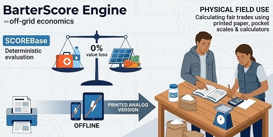

# BarterScore Engine (v1.1.0)

**A Local-First library for Collapse Informatics and Off-Grid Economics.**
*(Maktaba ya Local-First kwa Teknolojia ya Habari Wakati wa Dharura na Uchumi Bila Mtandao.)*

> **Lugha:**
> [**English (en-US)**](../README.md) · [**Português (pt-BR)**](./README.pt-BR.md) · [**Español (es-ES)**](./README.es-ES.md) · [**Français (fr-FR)**](./README.fr-FR.md) · [**Русский (ru-RU)**](./README.ru-RU.md) · [**Kiswahili (sw-KE)**](./README.sw-KE.md) · [**العربية (ar-SA)**](./README.ar-SA.md) · [**简体中文 (zh-Hans)**](./README.zh-Hans.md) · [**Mwongozo wa Karatasi (`OFFLINE_MANUAL.sw-KE.md`)**](./OFFLINE_MANUAL.sw-KE.md)

---

[](https://barterscoreengine.github.io/barterscore/manual_generator.html)

---
<p align="center">
  
</p>

**BarterScore Engine** ni mfumo wa kihisabati usiotegemea mtandao (*100% offline-first*), usio na utegemezi wa maktaba za nje (*zero-dependency*), na orodha rasmi ya bidhaa na huduma 128 iliyoundwa kukokotoa thamani halisi ya kimwili, kilishe na kiutendaji ya bidhaa muhimu pamoja na huduma za kitaalamu za binadamu kwa ajili ya biashara ya kubadilishana vitu (*barter*) wakati wa kukatika kwa minyororo ya usambazaji, majanga ya kibinadamu na kuporomoka kwa mifumo ya kiraia.

Ikiwa chini ya leseni ya [**Apache License 2.0**](https://www.apache.org/licenses/LICENSE-2.0), usanifu wote umeandikwa kwa **Vanilla JavaScript safi (ES6+ UMD)** na **HTML5/CSS3** asilia, ukifanya kazi sawasawa kupitia itifaki ya ndani ya `file://` (kwa kubofya mara mbili bila Node.js, bila seva za wavuti wala mtandao wa intaneti), CommonJS (`module.exports`) na ES Modules.

---

## Yaliyomo

1. [Misingi Mikuu ya Usanifu](#1-misingi-mikuu-ya-usanifu)
2. [Kanuni Rasmi ya Kihisabati](#2-kanuni-rasmi-ya-kihisabati)
3. [Mbinu za Kisayansi, Vipimo vya Urekebishaji na Vyanzo Rasmi (Bofya-1 + Ukaguzi Bila Mtandao)](#3-mbinu-za-kisayansi-vipimo-vya-urekebishaji-na-vyanzo-rasmi-bofya-1--ukaguzi-bila-mtandao)
4. [Mkataba wa Muundo wa Data na Usanifishaji wa Kisayansi](#4-mkataba-wa-muundo-wa-data-na-usanifishaji-wa-kisayansi)
5. [Uanzishaji wa Bofya-1 Bila Mtandao, Uchapishaji wa Mwongozo wa Karatasi na Muundo wa Hifadhi](#5-uanzishaji-wa-bofya-1-bila-mtandao-uchapishaji-wa-mwongozo-wa-karatasi-na-muundo-wa-hifadhi)
6. [Mwongozo wa Kuunganisha kwa Wasanidi Programu na Marejeleo ya API](#6-mwongozo-wa-kuunganisha-kwa-wasanidi-programu-na-marejeleo-ya-api)
7. [Jinsi ya Kuongeza Bidhaa ya 129+ au Kifurushi Kipya cha Lugha](#7-jinsi-ya-kuongeza-bidhaa-ya-129-au-kifurushi-kipya-cha-lugha)
8. [Leseni na Utawala](#8-leseni-na-utawala)

---

## 1. Misingi Mikuu ya Usanifu

- **Sifuri Utegemezi Wakati wa Uendeshaji (`file://` Kwanza):** Kila moduli katika `src/`, `data/` na `locales/` inatumia muundo mseto wa UMD unaopakia `window.BarterCore` kwa ajili ya kufanya kazi moja kwa moja kwenye kivinjari bila vizuizi vya CORS, huku pia ikiunga mkono `module.exports`.
- **Utenganisho Kamili wa Fizikia dhidi ya Lugha:** Vigezo vya kimwili na vya lishe vimehifadhiwa pekee katika `data/items_core.js` kwa vitambulisho vya `snake_case`. Tafsiri za kibinadamu zimehifadhiwa katika `locales/[lang].js` kwa kufuata kiwango cha [**IETF BCP 47 / RFC 5646**](https://www.rfc-editor.org/info/bcp47) (`en-US`, `pt-BR`, `es-ES`, `fr-FR`, `ru-RU`, `sw-KE`, `ar-SA`, `zh-Hans`) pamoja na mfumo wa kurudi nyuma (*Fallback*) wa ngazi tatu:
  ```text
  Lugha Iliyochaguliwa  ───►  en-US (Msingi Rasmi)  ───►  Kitambulisho cha Kiufundi (ID)
  ```
- **Sifuri Chapa za Kibiashara:** Alama za biashara zimepigwa marufuku kabisa. Bidhaa zote zimesanifishwa kwa **Kipimo Kidogo Zaidi cha Matumizi** (`kidonge 1`, `betri 1`, `chupa 1 ya 100 mL`, `mfuko 1 wa 1000 g`) kwa kutumia majina ya [**WHO INN**](https://www.who.int/teams/health-product-and-policy-standards/inn) ([**KEML — Orodha ya Dawa Muhimu ya Kenya / PPB**](https://web.pharmacyboardkenya.org/) kwa `sw-KE`) kwa dawa, [**KEBS / IEC 60086 na 61960**](https://webstore.iec.ch/en/publication/603) kwa betri, na [**Codex Alimentarius (FAO/WHO)**](https://www.fao.org/fao-who-codexalimentarius/) / [**Jedwali la Muundo wa Vyakula la Kenya (KFCT) & KEBS/EAS**](https://www.kebs.org/) kwa vyakula.

---

## 2. Kanuni Rasmi ya Kihisabati

### 2.1. Fahirisi ya Lishe (`IN`)
Kwa bidhaa zisizo za chakula (`is_food: false`), `IN = 1.0`. Kwa vyakula vyenye kalori (`is_food: true`), `IN` hutathmini uwiano wa kalori za protini na mafuta pamoja na wingi wa virutubisho vidogo muhimu, ikibanwa (`Clamp`) ndani ya wigo wa `[0.5, 2.5]`:

```text
MacroFactor = (pct_kcal_protein × 1.5) + (pct_kcal_fat × 1.0) - (pct_kcal_added_sugar × 1.2)
MicroFactor = (+0.3 ikiwa high_vit_c) + (+0.2 ikiwa high_sodium_potassium) + (+0.2 ikiwa high_calcium_iron)
IN          = Clamp(1.0 + MacroFactor + MicroFactor, 0.5, 2.5)
```

### 2.2. Alama ya Msingi (`ScoreBase`) na Uchakavu wa Muda wa Matumizi kwa Wakati Halisi
Inasawazisha nishati ya kalori au Msingi wa Nishati Sawa (`E`) dhidi ya mzigo wa uzito na ujazo wa usafirishaji (`P + Vol + 0.1`), muda wa kuhifadhi kwa logaridhamu ya msingi 10 (`log₁₀(V + 1)`), gharama ya maandalizi (`CP`), umuhimu wa kisaikolojia (`FP`) na uimara wa kifungashio (`Frag`):

```text
ScoreBase = ( (E × IN) / (P + Vol + 0.1) ) × log₁₀(V + 1) × CP × FP × Frag
```

- **Uchakavu kwa Wakati Halisi:** Wakati siku zilizobaki za matumizi `current_lifecycle_remaining` (au `offerRemainingDays`) zinapoingizwa, zinachukua nafasi ya muda wa kawaida `lifecycle_units` (`V`). Ikiwa `V ≤ 0`, bidhaa imekwisha muda wake na `ScoreBase = 0`.

### 2.3. Kirekebishaji cha Muktadha wa Nje (`MEC`) na Alama ya Mwisho

```text
ScoreFinal = ScoreBase × MEC
```

- **`acute_collapse` (Kuporomoka Kukali kwa Mfumo):** Kategoria ya `cat_store_of_value` (madini ya thamani) inashushwa hadi **`0.01x`**, wakati maji ya kunywa, vifaa vya kuzuiauvujaji wa damu, antibiotiki na vyakula vilivyo tayari kuliwa hupata viongeza thamani vya uhaba mkali.
- **`economic_reconstruction` (Ujenzi Upya wa Kiuchumi):** Kategoria ya `cat_store_of_value` inapanda hadi **`5.0x`**, pamoja na zana za kazi za mikono, mbegu za kilimo, paneli za jua na redio za mawasiliano za VHF/UHF.

### 2.4. Uwiano wa Kubadilishana na Tahadhari ya Kutogawanyika (`calculateTrade`)
Kwa bidhaa inayotolewa `A` (idadi `Q_A`) na bidhaa inayoombwa `B`:

```text
Q_B_halisi = ( ScoreFinal(A) × Q_A ) / ScoreFinal(B)
```

Ikiwa bidhaa `B` haigawanyiki (`is_divisible: false`), injini hukadiria idadi inayopendekezwa hadi nambari nzima ya karibu (`Q_B_pendekezo = max(1, round(Q_B_halisi))`) na kutoa ripoti ya `trade_imbalance` / `tradeImbalanceWarning` inayoeleza waziwazi **nani anadaiwa chenji na nani** (`UNADAIWA CHENJI NA UPANDE WA PILI` au `UPANDE WA PILI UNAWAJIBIKA KUKUPA CHENJI`), asilimia kamili ya tofauti, na mapendekezo ya kulipa chenji kwa kutumia bidhaa zinazogawanyika (`g`, `ml`, `un`).

---

## 3. Mbinu za Kisayansi, Vipimo vya Urekebishaji na Vyanzo Rasmi (Bofya-1 + Ukaguzi Bila Mtandao)

### 3.0. Maana ya Kimwili ya `Alama 1 ya BarterScore (1 pt)` na Kwa Nini Bidhaa B Ina Thamani `2x` ya Bidhaa A
Kwa uchambuzi wa vipimo vya `ScoreBase = ((E × IN) / (P + Vol + 0.1)) × log₁₀(V + 1) × CP × FP × Frag`:
- **Ufafanuzi wa Kimwili wa `1.0000 pt`:** **`Alama 1 ya BarterScore`** inawakilisha **Kilokalori 1 Bora ya Kuokoa Maisha (`E × IN = 1`) kwa kila kipimo cha Mzigo wa Usafirishaji wa Uzito na Ujazo (`P + Vol + 0.1 = 1.0`) kinachodumu kwa Muongo 1 wa Logaridhamu ya Muda wa Matumizi (`V = siku 9` → `log₁₀(10) = 1.0`) katika utayari wa wastani wa matumizi (`CP = 1.0`, `FP = 1.0`, `Frag = 1.0`)**.

### 3.1. Vyanzo Rasmi vya Kisayansi, Udhibiti na Kibinadamu (Nakala ya Nje ya Mtandao katika `audit_sources/` + Viungo vya Bofya-1)

| Eneo / Upeo | Taasisi na Nambari Halisi ya Hati / Rekodi | Kiungo cha Moja kwa Moja cha Uthibitishaji (Bofya-1) |
| :--- | :--- | :--- |
| **Kabati ya Ukaguzi Bila Mtandao** | Saraka ya Hifadhi ya Ndani (`audit_sources/`) | [`../audit_sources/OFFLINE_AUDIT_DOSSIER.md`](../audit_sources/OFFLINE_AUDIT_DOSSIER.md) |
| **Lishe: Mchele Mweupe (`365 kcal/100g`)** | USDA FoodData Central — `FDC ID: 169756` (`NDB 20444`) | [https://fdc.nal.usda.gov/food-details/169756/nutrients](https://fdc.nal.usda.gov/food-details/169756/nutrients) |
| **Lishe: Maharagwe Makavu (`329–341 kcal/100g`)** | USDA FoodData Central — `FDC ID: 173734` (`NDB 16014`) & TBCA `C0113A` | [https://fdc.nal.usda.gov/food-details/173734/nutrients](https://fdc.nal.usda.gov/food-details/173734/nutrients) |
| **Lishe: Asali, Sukari na Mafuta** | USDA FDC IDs `169640`, `169655` na `171411` | [https://fdc.nal.usda.gov/food-details/169640/nutrients](https://fdc.nal.usda.gov/food-details/169640/nutrients) |
| **Viwango vya Kimataifa vya Chakula** | Tume ya FAO/WHO Codex Alimentarius | [https://www.fao.org/fao-who-codexalimentarius/](https://www.fao.org/fao-who-codexalimentarius/) |
| **Dawa Muhimu (`J01CA04`, n.k.)** | Orodha ya 23 ya WHO EML (`WHO/MHP/HPS/EML/2023.02`) | [https://iris.who.int/handle/10665/371090](https://iris.who.int/handle/10665/371090) |
| **Chumvi za Kurudisha Maji Mwilini (`20.5 g/L`)** | WHO / UNICEF Low-Osmolarity ORS (`WHO/FCH/CAH/06.1`) | [https://iris.who.int/handle/10665/69227](https://iris.who.int/handle/10665/69227) |
| **Majina ya Dawa yasiyo ya Kibiashara** | WHO International Nonproprietary Names (INN) | [https://www.who.int/teams/health-product-and-policy-standards/inn](https://www.who.int/teams/health-product-and-policy-standards/inn) |
| **Vifurushi vya Afya vya Dharura** | WHO / UNHCR / UNICEF IEHK 2017 | [https://www.who.int/emergencies/emergency-health-kits/interagency-emergency-health-kit-2017](https://www.who.int/emergencies/emergency-health-kits/interagency-emergency-health-kit-2017) |
| **Matibabu ya Majeraha na Damu** | Miongozo ya CoTCCC / US DoD TCCC | [https://deployedmedicine.com/market/31](https://deployedmedicine.com/market/31) |
| **Kinga ya Tezi ya Koo dhidi ya Mionzi** | Mwongozo wa US FDA Des 2001 — Potassium Iodide (`130 mg`) | [https://www.fda.gov/drugs/bioterrorism-and-drug-preparedness/frequently-asked-questions-potassium-iodide-ki](https://www.fda.gov/drugs/bioterrorism-and-drug-preparedness/frequently-asked-questions-potassium-iodide-ki) |
| **Majina Rasmi ya `en-US`** | United States Pharmacopeia (USP) & FDA Orange Book | [https://www.usp.org/](https://www.usp.org/) · [https://www.accessdata.fda.gov/scripts/cder/ob/](https://www.accessdata.fda.gov/scripts/cder/ob/) |
| **Majina Rasmi ya `pt-BR`** | DCB / ANVISA (Denominação Comum Brasileira) | [https://www.gov.br/anvisa/pt-br/assuntos/farmacopeia/dcb](https://www.gov.br/anvisa/pt-br/assuntos/farmacopeia/dcb) |
| **Majina Rasmi ya `es-ES`** | DOE / CIMA AEMPS & BOE `BOE-A-1967-16485` (CAE) | [https://cima.aemps.es/](https://cima.aemps.es/) · [https://www.boe.es/buscar/act.php?id=BOE-A-1967-16485](https://www.boe.es/buscar/act.php?id=BOE-A-1967-16485) |
| **Majina Rasmi ya `fr-FR`** | DCI / ANSM (Pharmacopée Française) & ANSES Table Ciqual | [https://ansm.sante.fr/documents/reference/pharmacopee](https://ansm.sante.fr/documents/reference/pharmacopee) · [https://ciqual.anses.fr/](https://ciqual.anses.fr/) |
| **Majina Rasmi ya `ru-RU`** | МНН / ГРЛС Минздрава РФ (ГФ РФ XV) & Росстандарт (ГОСТ) | [https://grls.rosminzdrav.ru/](https://grls.rosminzdrav.ru/) · [https://protect.gost.ru/](https://protect.gost.ru/) |
| **Majina Rasmi ya `sw-KE`** | KEML / PPB Kenya (Pharmacy and Poisons Board) & KEBS / KFCT | [https://web.pharmacyboardkenya.org/](https://web.pharmacyboardkenya.org/) · [https://www.kebs.org/](https://www.kebs.org/) |
| **Majina Rasmi ya `ar-SA`** | SFDA (Saudi Food & Drug Authority) & Viwango vya SASO / GSO | [https://www.sfda.gov.sa/](https://www.sfda.gov.sa/) · [https://www.saso.gov.sa/](https://www.saso.gov.sa/) |
| **Majina Rasmi ya `zh-Hans`** | Chinese Pharmacopoeia (ChP) & SAMR GB Standards | [https://www.chp.org.cn/](https://www.chp.org.cn/) · [https://openstd.samr.gov.cn/](https://openstd.samr.gov.cn/) |
| **Maji na Vidonge vya NaDCC (`67mg/20L`)** | Sphere WASH Std 2.1 (`15L/siku`) & WHO GDWQ `978-92-4-154995-0` | [https://spherestandards.org/handbook/editions/](https://spherestandards.org/handbook/editions/) · [https://www.who.int/publications/i/item/9789241549950](https://www.who.int/publications/i/item/9789241549950) |
| **Betri (`LR6`, `LR03`, `INR18650`)** | IEC 60086-2 & IEC 61960-3 | [https://webstore.iec.ch/en/publication/603](https://webstore.iec.ch/en/publication/603) |
| **Barakoa za Kinga (`N95 / FFP2`)** | KEBS KS EAS / CDC NIOSH `42 CFR Part 84` | [https://www.cdc.gov/niosh/npptl/topics/respirators/disp_part/n95list1.html](https://www.cdc.gov/niosh/npptl/topics/respirators/disp_part/n95list1.html) |
| **Madini ya Thamani (`999.0 Fine`)** | LBMA Good Delivery Assay Specifications | [https://www.lbma.org.uk/good-delivery/about-good-delivery](https://www.lbma.org.uk/good-delivery/about-good-delivery) |
| **Upasuaji wa Dharura na Ukunga** | WHO IMEESC & WHO/UNFPA/UNICEF IMPAC (`978-92-4-156549-3`) | [https://www.who.int/publications/i/item/9789241565493](https://www.who.int/publications/i/item/9789241565493) |
| **Kazi za Kiufundi na Kimetaboliki** | ILO ISCO-08 & ISO 8996 | [https://ilostat.ilo.org/methods/concepts-and-definitions/classification-occupation/](https://ilostat.ilo.org/methods/concepts-and-definitions/classification-occupation/) · [https://www.iso.org/standard/74443.html](https://www.iso.org/standard/74443.html) |
| **Mifumo ya IT Bila Mtandao na Ukarabati wa PCB** | IEEE 802.11s, ISO/IEC 27037, IPC-7711/7721 & IEC 61131-3 | [https://standards.ieee.org/ieee/802.11s/4570/](https://standards.ieee.org/ieee/802.11s/4570/) · [https://www.iso.org/standard/44381.html](https://www.iso.org/standard/44381.html) |
| **Elimu ya Kiufundi na Utafsiri** | UNESCO ISCED, WHO/ICRC BEC & ISO 17100:2015 | [https://uis.unesco.org/en/topic/international-standard-classification-education-isced](https://uis.unesco.org/en/topic/international-standard-classification-education-isced) · [https://www.iso.org/standard/59149.html](https://www.iso.org/standard/59149.html) |

---

## 4. Mkataba wa Muundo wa Data na Usanifishaji wa Kisayansi

Kila kipengee katika `data/items_core.js` au kinachosajiliwa kupitia `BarterEngine.registerCustomItems([item])` kinakaguliwa na `window.BarterCore.Validator.validateItem(item)`:

| Sifa | Aina | Vizuizi / Thamani Zinazoruhusiwa |
| :--- | :--- | :--- |
| `id` | `string` | Herufi ndogo za `snake_case` (`/^[a-z][a-z0-9_]{2,120}$/`), bila nambari tupu, bila chapa za kibiashara |
| `category` | `string` | `cat_staple_foods`, `cat_critical_nutrition`, `cat_spices_morale`, `cat_pharma_essential`, `cat_trauma_hygiene`, `cat_water_fire_shelter`, `cat_tools_energy_comms`, `cat_store_of_value`, `cat_essential_services` |
| `is_food` | `boolean` | `true` kwa vyakula vyenye kalori; `false` kwa bidhaa zisizo za chakula, dawa, zana na huduma |
| `is_divisible` | `boolean` | `true` ikiwa inagawanyika katika `sub_units`; `false` ikiwa inauzwa kama kipande kizima pekee |
| `sub_units` | `number` | Nambari nzima `≥ 1` (`1` kwa visivyogawanyika; jumla ya `g`, `ml` au vipande kwa vinavyogawanyika) |
| `unit_measure` | `string` | `"g"` \| `"ml"` \| `"un"` |
| `energy_or_utility_base` | `number` | `> 0` (Jumla halisi ya `kcal` kwa vyakula; `EEB` ndani ya `[500, 50000]` kwa visivyo vya chakula) |
| `weight_kg` | `number` | Uzito wa kimwili kwa kilo (`> 0`) |
| `volume_liters` | `number` | Ujazo wa kimwili kwa lita (`≥ 0`) |
| `lifecycle_units` | `number` | Muda wa matumizi wa bidhaa iliyofungwa au uimara wa huduma, kwa siku (`> 0`) |
| `cost_of_prep` | `number` | Kipimo cha urahisi wa maandalizi ndani ya `[0.5, 1.0]` |
| `psychological_factor` | `number` | Kipimo cha mahitaji ya kisaikolojia na moyo ndani ya `[1.0, 2.5]` |
| `fragility_index` | `number` | Kipimo cha uimara wa kifungashio ndani ya `[0.7, 1.2]` |
| `tags` | `string[]` | Safu isiyo tupu ya lebo za kiutendaji kwa `snake_case` |

---

## 5. Uanzishaji wa Bofya-1 Bila Mtandao, Uchapishaji wa Mwongozo wa Karatasi na Muundo wa Hifadhi

- **Windows (7 / 10 / 11):** Bofya mara mbili `start_windows.bat` kwenye mizizi ya mradi.
- **Linux / macOS / FreeBSD / OpenBSD:** Endesha `./start_unix.sh` (au `sh ./start_unix.sh`).
- **Kufungua Moja kwa Moja:** Bofya mara mbili `manual_generator.html` kwenye kidhibiti chochote cha faili cha kompyuta au simu.
- **Kuchapisha Mwongozo wa Karatasi wa Nje ya Mtandao (Ukurasa wa 1 Mwongozo Kamili + Hali 3 Sambamba):** Ndani ya `manual_generator.html`, chagua lugha ya **`Kiswahili (sw-KE)`** na ubofye **"Chapisha Mwongozo wa Karatasi"** (au `Ctrl+P` / `Cmd+P`). Mtindo wa `@media print` (`A4 landscape`) huficha vidhibiti na kuchapisha mwongozo kamili wa uwanjani.

### 5.1. Muundo wa Hifadhi (Repository Architecture)

```text
library/
├── .gitattributes                      # Inalazimisha LF kwa .sh, CRLF kwa .bat na sheria za GitHub Linguist
├── .gitignore                          # Kinga dhidi ya faili za muda za mfumo wa uendeshaji na IDE
├── LICENSE                             # Leseni rasmi ya Apache License 2.0
├── NOTICE                              # Ilani ya Lazima ya Umiliki (Kifungu 4d — Erisson Marques)
├── README.md                           # Nyaraka rasmi za Kiingereza na Marejeleo ya SDK
├── CHANGELOG.md                        # Historia ya matoleo ya Keep a Changelog v1.1.0
├── CONTRIBUTING.md                     # Sheria ya Inbound=Outbound na umiliki wa 100% wa ufadhili
├── package.json                        # Orodha ya kifurushi cha npm kisicho na utegemezi
├── server.js                           # Seva asilia ya HTTP ya Node.js kwa ukaguzi wa ndani
├── index.js                            # Kiingilio kikuu cha UMD cha kifurushi (@barterscoreengine/library)
├── index.d.ts                          # Matangazo rasmi ya aina za TypeScript kwa IDE na miradi ya nje
├── start_windows.bat                   # Kianzishaji cha Bofya-1 cha Windows (itifaki ya file://)
├── start_unix.sh                       # Kianzishaji cha Bofya-1 cha POSIX (Linux, macOS, BSD)
├── manual_generator.html               # Kiolesura cha nje ya mtandao, kiigaji cha biashara na kichapishaji cha A4
├── attachments/                        # Mabango, aikoni na rasilimali za picha za mradi
├── data/
│   └── items_core.js                   # Bidhaa na huduma 128 zilizosanifishwa (kategoria 9: bidhaa 100 + huduma 28) + kiolezo cha 129+
├── audit_sources/
│   ├── OFFLINE_AUDIT_DOSSIER.md        # Kabati ya nje ya mtandao ya vyanzo vya kisayansi na vipimo vya urekebishaji
│   └── offline_sources_registry.js     # Moduli ya UMD ya rekodi za kisayansi (window.BarterCore.AuditSources)
├── locales/
│   ├── en-US.js                        # Kiingereza (WHO INN / USP / Codex Alimentarius)
│   ├── pt-BR.js                        # Kireno (DCB-ANVISA / TBCA-TACO)
│   ├── es-ES.js                        # Kihispania (DOE-AEMPS / Código Alimentario Español)
│   ├── fr-FR.js                        # Kifaransa (DCI-ANSM / Pharmacopée Française / ANSES-Ciqual)
│   ├── ru-RU.js                        # Kirusi (MNN-GRLS Minzdrav RF / State Pharmacopoeia XV / GOST)
│   ├── sw-KE.js                        # Kiswahili (WHO INN / KEML-PPB Kenya / KEBS-KFCT)
│   ├── ar-SA.js                        # Kiarabu (WHO INN / SFDA / SASO-GSO / Codex Alimentarius)
│   └── zh-Hans.js                      # Kichina Rahisi (Chinese Pharmacopoeia ChP / GB)
├── docs/
│   ├── OFFLINE_MANUAL.md               # Mwongozo wa Karatasi wa Uwanjani kwa Kiingereza (en-US)
│   ├── OFFLINE_MANUAL.pt-BR.md         # Mwongozo wa Karatasi wa Uwanjani kwa Kireno cha Brazil
│   ├── OFFLINE_MANUAL.es-ES.md         # Mwongozo wa Karatasi wa Uwanjani kwa Kihispania
│   ├── OFFLINE_MANUAL.fr-FR.md         # Mwongozo wa Karatasi wa Uwanjani kwa Kifaransa
│   ├── OFFLINE_MANUAL.ru-RU.md         # Mwongozo wa Karatasi wa Uwanjani kwa Kirusi
│   ├── OFFLINE_MANUAL.sw-KE.md         # Mwongozo wa Karatasi wa Uwanjani kwa Kiswahili
│   ├── OFFLINE_MANUAL.ar-SA.md         # Mwongozo wa Karatasi wa Uwanjani kwa Kiarabu
│   ├── OFFLINE_MANUAL.zh-Hans.md       # Mwongozo wa Karatasi wa Uwanjani kwa Kichina Rahisi
│   ├── README.pt-BR.md                 # Nyaraka zilizotafsiriwa kwa Kireno cha Brazil
│   ├── README.es-ES.md                 # Nyaraka zilizotafsiriwa kwa Kihispania
│   ├── README.fr-FR.md                 # Nyaraka zilizotafsiriwa kwa Kifaransa
│   ├── README.ru-RU.md                 # Nyaraka zilizotafsiriwa kwa Kirusi
│   ├── README.sw-KE.md                 # Nyaraka zilizotafsiriwa kwa Kiswahili
│   ├── README.ar-SA.md                 # Nyaraka zilizotafsiriwa kwa Kiarabu
│   └── README.zh-Hans.md               # Nyaraka zilizotafsiriwa kwa Kichina Rahisi
└── src/
    ├── barter_engine.js                # Injini Kuu ya Kihisabati na Biashara ya UMD (Bila Utegemezi)
    └── validator.js                    # Kikaguzi cha Muundo, Orodha na Lugha cha UMD
```

---

## 6. Mwongozo wa Kuunganisha kwa Wasanidi Programu na Marejeleo ya API

```javascript
import { BarterEngine, Validator, ItemsCore, Locales, AuditSources } from '@barterscoreengine/library';

const engine = new BarterEngine({
  items: ItemsCore,
  locales: Locales,
  locale: 'sw-KE',
  crisisPhase: 'acute_collapse'
});

const itemScore = engine.evaluateItem('water_potable_sealed_1000ml');
console.log('Jina la Bidhaa:', engine.translate('water_potable_sealed_1000ml', 'name', 'sw-KE'));
console.log('Alama ya Mwisho:', itemScore.final_score); // 16458.3288
```

---

## 7. Jinsi ya Kuongeza Bidhaa ya 129+ au Kifurushi Kipya cha Lugha

Tumia `BarterEngine.registerCustomItems([item], { mode: 'merge', strict: true })` kusajili bidhaa mpya za kikanda kuanzia **Bidhaa ya 129+ (`Items 129+`)**, au nakili `locales/en-US.js` kwenda `locales/[bcp47-code].js` na ukague kwa `Validator.validateLocale(customLocale, ItemsCore)`.

---

## 8. Leseni na Utawala

Mradi huu unasambazwa chini ya leseni ya [**Apache License 2.0**](../LICENSE). Kwa mujibu wa Kifungu cha 4(d) cha Apache License 2.0, nakala zote au kazi zinazotokana na mradi huu lazima zihifadhi faili ya [`NOTICE`](../NOTICE) ikimtaja mwanzilishi na mtunzaji mkuu: **Erisson Marques** ([`https://github.com/erissontech`](https://github.com/erissontech)) na hifadhi rasmi ([`https://github.com/barterscoreengine/library`](https://github.com/barterscoreengine/library)).
